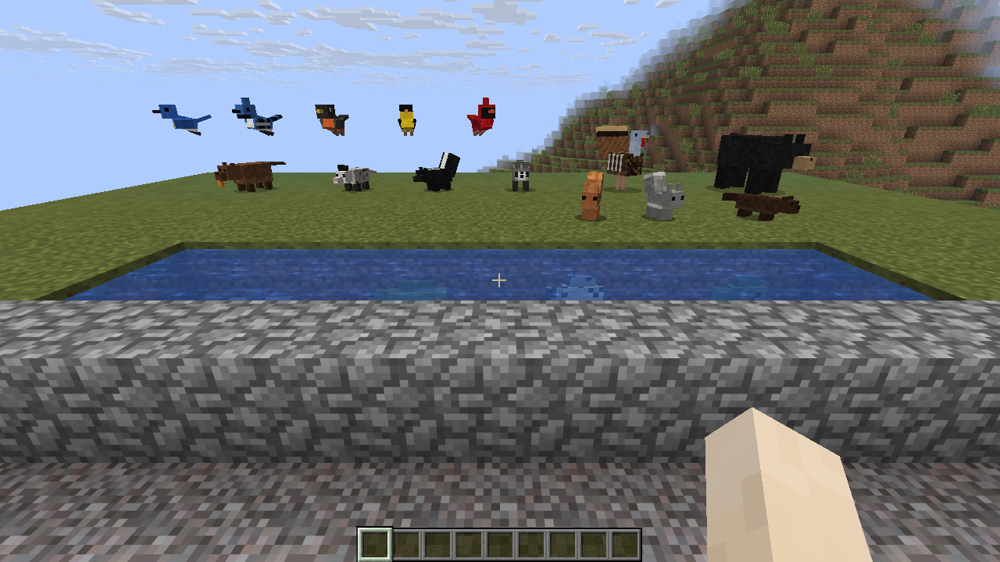
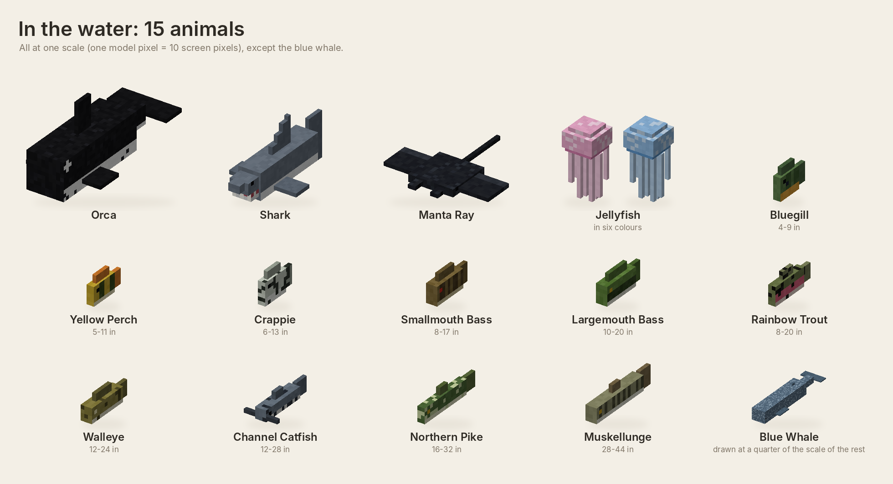
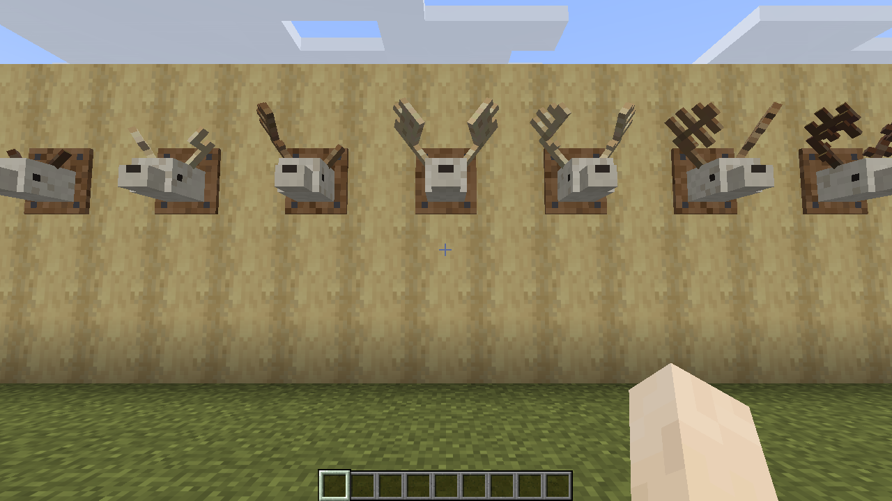
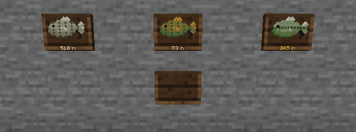
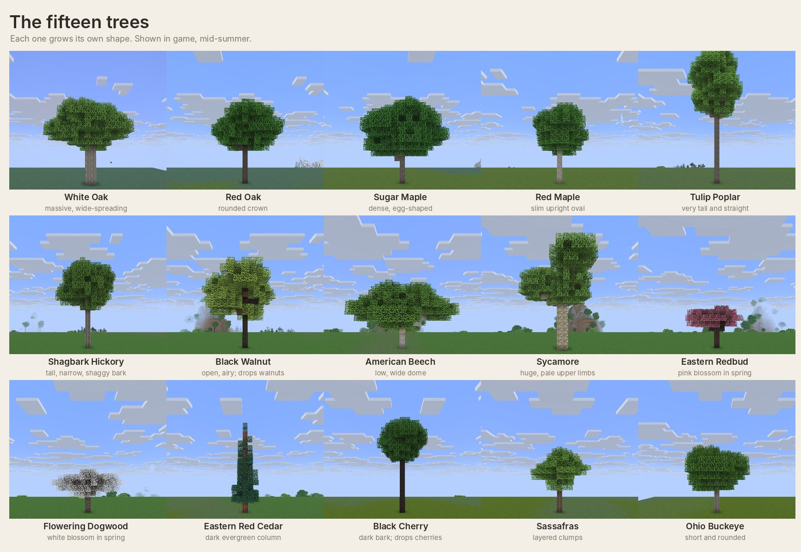
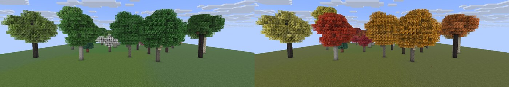
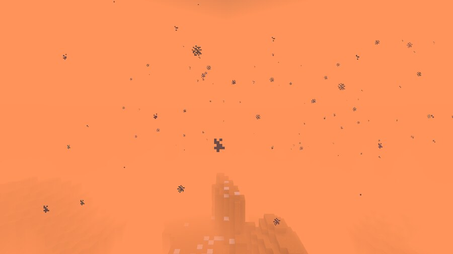

# RyanCraft

A Fabric mod for **Minecraft 1.21.11**: the feel of 2012, Tekkit-era Minecraft 1.2.5, with woods full of Kentucky
wildlife, a real year of seasons, and vanilla-style pipes and engines.

**[Download the latest release](https://github.com/selenoyl/RyanCraft/releases/latest)** · [Changelog](docs/CHANGELOG.md) · [Roadmap](ROADMAP.md)

## What's in it
- **60+ animals** (deer with antlers that grow over time, bears with cubs, turkey flocks, eagles, whales and more), each with its own behaviour, sounds and spawn egg
- **Hunting and fishing**: trophy bucks and skull mounts, fish with real-world lengths, trophy fish for the wall
- **Fifteen eastern US trees**, each with a full wood set
- **Seasons and thirst**: autumn colours, snowy winters, spring thaw, and a thirst bar beside hunger
- **Pipes, engines, tanks and pumps**, an Ender Terminal for storage, and steel from an engine-stoked blast furnace
- **The classic 1.2.5 look and sound** built in, with MAtmos-style ambience

## Wildlife

**Big game:**
- whitetail and black-tailed deer, elk, moose, reindeer and pronghorn
- bison, black and grizzly bears, cougars, bobcats, coyotes and boars

**Small critters:** raccoons, skunks, opossums, beavers, otters, mink, groundhogs, porcupines, squirrels and chipmunks.

**Birds:**
- turkeys, crows (tame one for your shoulder), bald and golden eagles, hawks, vultures, owls, herons
- geese, ducks, swans, bobwhites, woodpeckers, hummingbirds and six songbirds

**Water and swamp life:**
- orcas, blue whales, sharks, manta rays and jellyfish
- alligators, bullfrogs, frogs and toads, box turtles and rattlesnakes

**Also:** twenty butterfly species, fireflies, zebras and the moobloom.

Animals act like the real thing:
- Deer bolt at 14 blocks, but only notice you at 5 if you sneak, and camo-dyed leather helps.
- A bear only fights if you crowd her or her cubs, and runs when she's beaten down.
- Toms defend the flock, moose charge, and coyotes pile in as a pack.

**Antlers grow with age**, from spikes up to a ten-point Trophy Buck. Rare drop-tine, cactus, palmated and lopsided
racks come in three antler colours. Every antlered deer drops a skull mount with its exact rack.

## Fishing
**Ten freshwater game fish** live in rivers, lakes and swamps; the ocean gives cod, salmon and pufferfish. Catfish and
walleye bite after dark.

**Every fish has a length**, true to life: most bluegill are 4 to 9 inches, and most muskies 28 to 44. About 1 in 50
is a trophy, up to the real-world record, and about 1 in 1000 is a Legendary fish beyond it.

Every catch is called out, and the **Angler's Logbook** keeps your personal bests. Mount your trophies on a
**Fish Plaque**.

## Trees and seasons
**The trees:**
- **Species:** white and red oak, sugar and red maple, tulip poplar, shagbark hickory, black walnut, beech, sycamore, redbud, dogwood, red cedar, black cherry, sassafras and Ohio buckeye.
- **Shape:** each tree grows its own shape, with limbs ending in leaf clusters inside an outline that fits the species.
- **Wood:** every species has a full wood set, with its own door and trapdoor design.
- **Fruit:** cherries and black walnuts fall from the leaves.

**The year runs Serene Seasons-style**: early, mid and late spring, summer, autumn and winter, 8 days each.
- Leaves turn gold, red and orange through autumn.
- Winter brings snow and frozen ponds to temperate biomes.
- In spring the snow melts and the trees leaf out again, redbud and dogwood back to blossom.
- Crops stall in winter unless they're in a greenhouse.
- The Season Calendar tells you the date, and `/season set` jumps to any season.

**Dust storms**: a thunderstorm over the desert or badlands brings a dust storm instead. Thick sandy fog (rust-red in the badlands), blowing dust, a howling wind, and thirst runs out faster.

**Thirst**: a row of droplets over the hunger bar. It drains slowly, so it's there without being a chore, and faster when you sprint or stand in the desert sun.
- Sip from any water with an empty hand.
- Water bottles go down in three sips, and the bottle shows how full it is.
- Milk, stews, honey, melon and berries also quench. Like hunger, drinks give hidden hydration that runs out before the bar drops.
- Run dry and you stop healing and start to suffer, like starving.

## Pipes, engines and the Ender Terminal
Tekkit-style transport that feels vanilla. You can watch items ride through the pipes.
- **Pipes:**
  - wooden pipes pull from inventories
  - gold pipes speed items up
  - iron pipes direct items one way
  - diamond pipes sort by colour-coded filters
  - obsidian pipes vacuum up dropped items
  - fluid pipes carry water and lava
- **Engines:** redstone engines and coal-burning Stirling engines warm up, then pulse faster. Stack engines in a line to add their power together.
- **Steel:** point a running engine at a blast furnace to work it like a bellows. While it's stoked and burning fuel, iron ingots turn into steel ingots, for building and for the cannons and muskets to come. Steel comes as blocks, cut steel (with stairs and slabs), plating, chiseled steel, a see-through grate, bars, a door and a trapdoor.

- **Tanks and pumps:**
  - stacking glass tanks
  - an iron-hooped vat that collects rain
  - an Archimedes screw pump that lowers its intake into the pool
  - a hand pump that draws groundwater into a tank beside it
- **Ender Terminal:** an end portal frame wired with redstone. It sees every chest with an Ender Pipe on it. Click an item and the Ender Pipe pulls it out, then it rides the pipes back to you.

## The 1.2.5 feel
**Classic look and sound:**
- A built-in *Classic 1.2.5* resource pack brings back the 1.2.5 textures, GUI, sounds, title panorama and the original C418 music, with nothing to download.
- Programmer Art sits underneath it for newer blocks.
- The 1.2.5 rose is back, along with deep-blue water.

**Ambience:**
- Wind that builds with altitude.
- Cicadas on summer days, crickets and frogs at night.
- A brook where the water actually runs, birdsong at dawn, cave drips.

All the ambience is original synthesised sound, made in the spirit of MAtmos.

**Small touches:**
- skeleton variants
- armadillos, goats and turtles drop their scutes and horns when killed
- Beta 1.7 biomes (with [TerraBlender](https://modrinth.com/mod/terrablender))
- no chat reporting
- old-style splash text

Everything can be switched off in `config/ryancraft.json`.

## Install
1. Install [Fabric Loader](https://fabricmc.net/use/) 0.20.1+ for Minecraft 1.21.11.
2. Put the [latest RyanCraft jar](https://github.com/selenoyl/RyanCraft/releases/latest) and [Fabric API](https://modrinth.com/mod/fabric-api) in `.minecraft/mods`. Add [TerraBlender](https://modrinth.com/mod/terrablender) too if you want the Beta biomes.
3. That's it: the classic pack ships inside the mod and switches on by default.

## Build
**Mod:** needs Java 21. Run `./gradlew build` (the jar lands in `build/libs/`) or `./gradlew runClient`.

**Art, sound and data:** the generators are in `tools/`. Start with `python3 tools/resources.py` for the JSON data and `python3 tools/critters.py` for mob models and textures.

**Releasing:** bump `mod_version` in `gradle.properties` and add a changelog section. A GitHub Release is published automatically.
