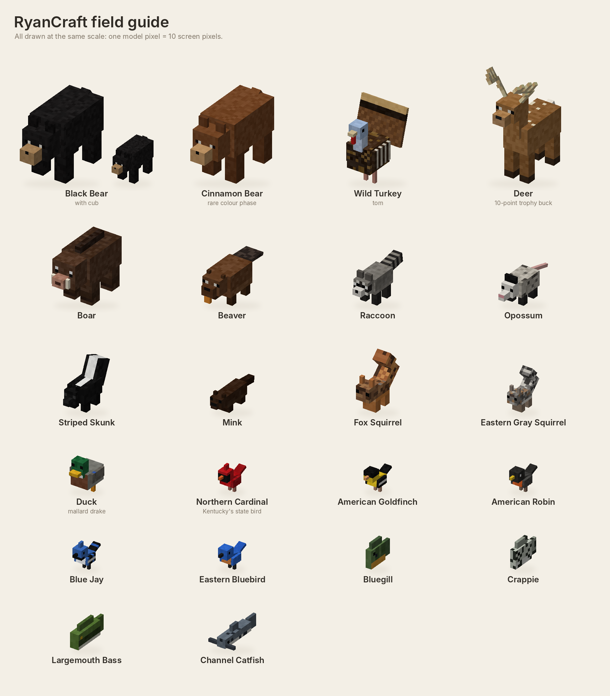
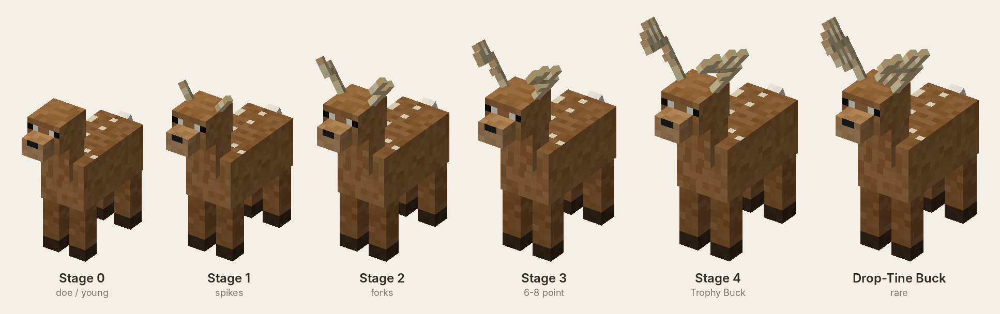
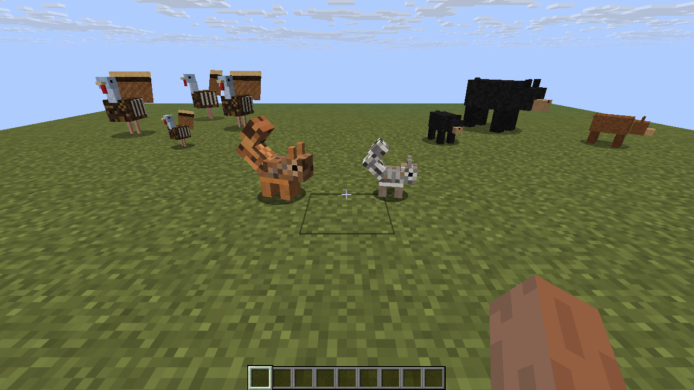

# RyanCraft

A Fabric mod for **Minecraft 1.21.11**: the feel of 2012, Tekkit-era Minecraft 1.2.5, plus a woods full of Kentucky wildlife.

## Classic 1.2.5 pack
On first launch the mod downloads the **official 1.2.5 files from Mojang's servers** (the same ones the launcher uses) and builds a resource pack on your machine called *RyanCraft Classic 1.2.5*, then switches it on. No Mojang assets are shipped in this mod.
- **Textures**: every 1.2.5 block and item (yes, *that* gravel), the old crack animation, old Steve and zombie, the 1.2.5 font, clouds, rain, snow, and the old grass/foliage colours. Mobs that changed shape since 1.2.5 (like the new warm and cold chickens, cows and pigs) keep their modern look; only mobs whose texture layout still matches get the old skin.
- **GUI**: the 1.2.5 hotbar, hearts, hunger, armor, XP bar, crosshair and buttons, and the original title-screen panorama.
- **Sounds**: the 1.2.5 sound set: footsteps, digging, damage, the old mob sounds, caves, rain, doors, explosions.
- **Music**: only the original C418 tracks (calm 1-3, hal 1-4, nuance 1-2, piano 1-3), everywhere.
- **Programmer Art** is switched on underneath so blocks added after 1.2.5 still look the part.

Turn it off any time in *Resource Packs*. Each part can be toggled in `config/ryancraft.json` (`classicTextures`, `classicSounds`, `classicMusic`, `classicProgrammerArt`).

## Atmosphere (MAtmos-style)
The mod reads your surroundings every second (biome, time of day, how many trees are around, running water, caves, altitude, rain) and mixes:
- **Beds that fade in and out**: wind (stronger high up, on mountains and in storms), howling wind in the snow, leaves rustling and distant twitter in forests, cricket chorus on warm nights, frogs in swamps and ponds, a babbling brook placed where the running water actually is, surf at the coast, rain pattering on leaves, deep cave air.
- **Calls placed around you in 3D**: songbirds (loudest at dawn), woodpeckers, cuckoos, crows, hawks over open country, gulls at the beach, owls and distant wolf howls at night, bullfrogs, cave drips and rumbles, gusts through the leaves.
- **The MAtmos big three, remade from scratch**:
  - **Wind**: a light breeze anywhere under open sky that builds with altitude and storms, howling in the snow, with big gusts rolling over high ground.
  - **Cicadas**: the drone of a hot summer day in the trees, swelling toward midday.
  - **Splashing water**: sloshing splashes as you wade or swim, paced by how fast you move, and waterfalls that roar from where the water actually falls.
- Also from the MAtmos spirit: stones rattling down an old shaft somewhere deep underground.
- Wild turkeys **shock-gobble** back at owls, crows and hawks, like the real thing.

All of it plays on the *Ambient/Environment* volume slider and has subtitles. `ambience` / `ambienceVolume` in the config. The sounds are original synths (see `tools/synth_ambience.py`), made in the spirit of [MAtmos](https://github.com/makamys/MAtmos) by Hurricaaane. MAtmos's code is WTFPL, but its classic 2012 soundpack has no stated license, so none of its audio is used here. Any resource pack can replace them with real recordings, since the files live under `assets/ryancraft/sounds/ambience/`.

## Animals

*Rendered from the game's own models and textures with `python3 tools/render_iso.py`.*

| Animal | Where | What it does |
|---|---|---|
| **Wild Turkey** | Hardwood forests, meadows, plains | Roams in flocks of 4-7; gobbles at dawn and at thunder; toms fight back and the flock joins in; drops turkey and feathers |
| **Black Bear** (sometimes cinnamon) | Forests, taiga | See below |
| **Raccoon** | Forests, swamps | Climbs trees, keeps its distance, steals food left on the ground; tail drops for a **Coonskin Cap** |
| **Striped Skunk** | Forest edges, plains, meadows | Crowd it (or a wolf/fox does) and it sprays: nausea and blindness. Sneak past |
| **Opossum** | Forests, swamps, plains | Hisses; hit it and it **plays possum** for a few seconds |
| **Beaver** | Rivers, swamps | Swims, slaps its tail in alarm, bites back if attacked, leaves gnawed sticks |
| **Mink** | Rivers, swamps | Swims and hunts fish |
| **Eastern Gray / Fox Squirrel** | Woods (gray) and open woods/edges (fox) | Chatters, flees, runs straight up tree trunks. Grays are smaller, with salt-and-pepper fur and a silver-fringed tail; fox squirrels are bigger and rusty |
| **Songbirds** | Woods and fields | Northern Cardinal, American Goldfinch, American Robin, Blue Jay, Eastern Bluebird, each with its own song |
| **Bluegill, Crappie, Largemouth Bass, Channel Catfish** | Rivers, swamps | Bucket them, or catch them on a rod; cook for a fish fry |
| **Deer** | Forests, taiga, meadows | Very skittish; antlers grow with age (see below) |
| **Boar, Duck** | Forests, plains, rivers | Boar fights back; ducks drop feathers |

### Deer: antlers and hunting
**Antlers grow with age.** A deer ages only while its chunk is loaded, and goes up one stage every 2-3 in-game weeks (each deer on its own clock):
stage 0 (does and young) -> 1 spikes -> 2 forks -> 3 six-to-eight point -> 4 ten-point **Trophy Buck**. Fawns start once they're grown, and bigger racks come on bigger bodies.
Wild deer spawn at every stage (mostly younger, about one in ten a trophy).
The rare **Drop-Tine Buck** carries non-typical tines hanging off its beams: about 3% of big bucks spawn that way, and a few turn non-typical as they grow into it.

**They're skittish.** A deer notices you at about 14 blocks walking, 24 sprinting, and only 5 sneaking. Night and rain make you harder to notice. When one deer flags, the whole herd within 16 blocks bolts.
**Wear camo.** Each piece of leather armor dyed to blend in with the biome you're standing in cuts that distance by 15% (a full matching set: 40%, so sneaking in full camo gets you to about 2 blocks):

| Where you are | Dye your leather |
|---|---|
| Snowy biomes | White or light gray |
| Forests, taiga, jungle, swamps | Dark green or brown |
| Plains, meadows | Lime or green |
| Savanna, shrubland, badlands, desert | Yellow or brown |
| Mountains | Gray or light gray |

Close mixes count too, not just exact dye colours.

### Black bears
- **Peaceful most of the time.** Get within about 4 blocks (2.5 if you're sneaking), or near her cubs, and she fights.
- **Beat her down to half health and she runs**, keeping clear of players until she has healed back up. Bears heal slowly when left alone.
- **Sows roam the woods with one or two cubs.** Cubs stay cubs for 4 in-game days (normal babies grow up in 1), so you'll actually meet families out walking.
- **Grown cubs go their own way.** Every week or two of game time a sow may have a new litter, but only where there are fewer than 4 bears within ~100 blocks, so the woods don't fill up.

Breeding foods: turkey and songbirds take seeds; bears take berries, honey or fish; raccoons take berries, eggs or fish; squirrels take berries or seeds; beavers take saplings.

## Biomes
Rainforest, Seasonal Forest, Shrubland and Tundra (the Beta 1.7 set), placed by **[TerraBlender](https://modrinth.com/mod/terrablender)**. Without TerraBlender everything else still works.

## Other classic tweaks
All on by default; each can be switched off in `config/ryancraft.json`:
- `disableChatReporting`: never creates a chat-signing key, so your messages can't be reported. Vanilla servers with `enforce-secure-profile=true` will refuse you while this is on.
- `hideReportButton`, `disableProfanityFilter`, `classicDefaultSkins` (Steve or Alex only).
- No "Java Edition" badge, and Alpha/Beta-style splash text.

## Install
1. [Fabric Loader](https://fabricmc.net/use/) 0.20.1+ for 1.21.11.
2. Put `ryancraft-1.0.0.jar`, [Fabric API](https://modrinth.com/mod/fabric-api) and (for the biomes) TerraBlender in `.minecraft/mods`.
3. First launch needs internet once to build the classic pack (about 25 MB, cached in `.minecraft/ryancraft/cache`).

## Build
Needs Java 21: `./gradlew build` (jar in `build/libs/`), `./gradlew runClient`.

Regenerating art and sound: `python3 tools/critters.py` (models + textures from one spec), `python3 tools/check_fit.py` (fails if any head, leg, tail or ear floats free of its body), `python3 tools/synth_ambience.py` (needs numpy, scipy, ffmpeg), `python3 tools/resources.py` (JSON data).
