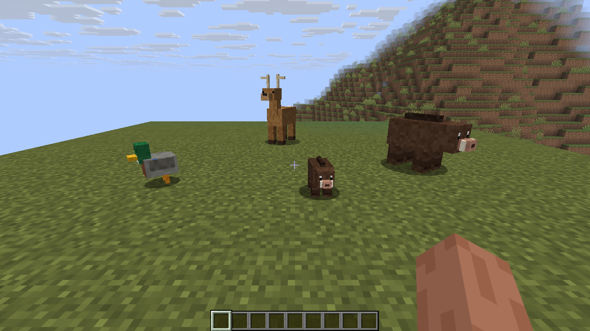
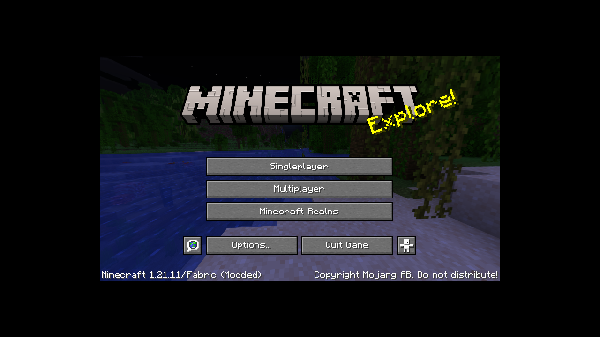

# RyanCraft

A Fabric mod for **Minecraft 1.21.11**: new animals in the old blocky style, the Beta biomes back, and a few classic-feeling tweaks.



## What's in it

### Animals
| Mob | Where | Behaviour | Drops | Breed with |
|---|---|---|---|---|
| **Boar** | Forests, taiga, Seasonal Forest, Rainforest | Neutral: hit it and it charges back | Porkchop, leather | Carrot, potato, beetroot |
| **Deer** | Forests, taiga, meadow, Seasonal Forest, Shrubland, Tundra | Runs from players. **Sneak** to get close | Venison, leather | Wheat, apple |
| **Duck** | Rivers, plains, swamps, Rainforest, Shrubland | Flutters down like a chicken, drops a feather now and then | Raw duck, feather | Seeds |

Venison and duck cook in a furnace, smoker or campfire.

### Biomes (the Beta 1.7 set)
- **Rainforest**: lush jungle trees, vines, melons, parrots
- **Seasonal Forest**: golden-green birch woods
- **Shrubland**: dry grass and bushes, horses, villages
- **Tundra**: open snowfields with rabbits, foxes, igloos

The biomes need **[TerraBlender](https://modrinth.com/mod/terrablender)** to generate. Without it, everything else in the mod still works.

### Classic tweaks
All on by default; each can be switched off in `config/ryancraft.json`.
- `disableChatReporting`: your client never creates a chat-signing key, so your messages can't be reported. A server running the mod also stops demanding signed chat. Vanilla servers with `enforce-secure-profile=true` will refuse you while this is on.
- `hideReportButton`: removes the Report button from Social Interactions.
- `disableProfanityFilter`: turns off the text filter on both client and server.
- `classicDefaultSkins`: players without a custom skin show as Steve or Alex only, chosen from their UUID the pre-1.19.3 way.
- Old-school title screen: no "Java Edition" badge under the logo, and an Alpha/Beta-style splash list.



## Install
1. Install [Fabric Loader](https://fabricmc.net/use/) 0.20.1+ for 1.21.11.
2. Put `ryancraft-1.0.0.jar`, [Fabric API](https://modrinth.com/mod/fabric-api) and (for the biomes) TerraBlender in `.minecraft/mods`.
3. The new biomes only generate in chunks created after installing. Start a new world, or explore far out.

## Build
Needs Java 21.
```
./gradlew build          # jar in build/libs/
./gradlew runClient      # dev client
./gradlew runServer      # dev server
```

Try it in-game: `/locate biome ryancraft:tundra`, `/summon ryancraft:deer`.
