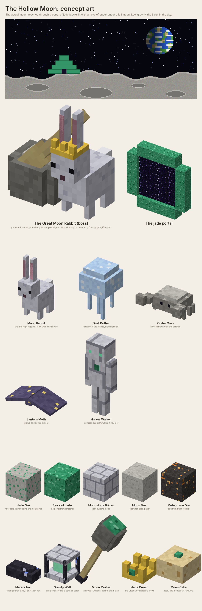

# RyanCraft roadmap

Ideas queued for later, roughly grouped. Struck-through items are built; see [docs/CHANGELOG.md](docs/CHANGELOG.md).

## Next up
- ~~**Seasons**~~ (built in 1.3.0). Still to do: antler shedding in late winter.
- ~~**Thirst bar**~~ (built in 1.4.0): drink from water or bottles; some foods give a little water.
- **Deep layer below deepslate** (Alex's Caves style): regular, toxic, frozen, underground-overworld and deep-dark caverns.
- ~~**Fishing loop**~~ (built): catch-and-measure fish, trophies, personal bests in the Angler's Logbook, fish plaques.
- **Squirrels that really climb**: run up trunks, cling sideways and hang upside down on bark.
- ~~**Old-school spawn eggs**~~ (built): redo the egg icons to look like the classic two-tone spotted eggs, cleaner and calmer.
- **Chipmunk eyes**: they're tiny, so the eyes may need to move to the sides of the head; check in game.

## Wildlife
**Deer family**
- ~~**Elk** and **moose**~~ (built)
- ~~**Black-tailed deer** (western coastal forests).~~ (built)
- ~~**Pronghorn**~~ (built)

**Predators and big game**
- ~~**Grizzly bear**~~ (built)
- **Elephants**, including big **war elephants** you can saddle and armour.
- ~~**Bobcat**~~ (built)
- ~~**Alligator** (swamps)~~ (built)

**Birds**
- ~~**Bald eagle** and **golden eagle**~~ (built)
- ~~**Hawks** (the ambience already has hawk calls to hook into)~~ (built)
- ~~**Vultures** circling high over open country~~ (built)

**Ocean**
- ~~**Whales**~~ (built), each with its own behaviour: **orcas** (hunt in pods), **blue whales** (huge, slow, surface to breathe and spout).
- ~~**Sharks**~~ (built)
- ~~**Manta rays**~~ (built)
- **Schools of ocean fish** that move together.

~~**Batch 2 prototypes**~~ (all built; docs/prototypes_2.png): zebra (a horse variant), American bison, cougar, river otter, groundhog,
porcupine, eastern box turtle, timber rattlesnake, bullfrog, great horned owl, great blue heron, Canada goose,
ruby-throated hummingbird, pileated woodpecker, northern bobwhite, jellyfish.

**Small life**
- ~~**Butterflies**~~ (built): many species like the tropical fish (wing patterns x colours); 20 eastern species, see docs/butterflies_chart.png
- ~~**Fireflies**~~ (built): drifting over plains and through the woods on summer nights (the game only has the firefly bush).
- ~~**Chipmunks**~~ (built)

**Canines**
- ~~**Coyotes**~~ (built): a smaller, untameable wolf. Like the black bear, mostly leaves you alone unless you get close;
  travels in loose packs the way vanilla wolves do.

**Songbirds**
- ~~**Mourning doves**~~ (built), with their iconic soft cooing call (in the songbird family and the ambience).

## Hunting
- **Hunting gear**: game calls (turkey and deer calls that draw animals in), a tree stand, and the like.
- **No pelt system for now**: vanilla mobs stay as they are, and coyotes drop no leather. Deer give buckskin
  leather like a cow. Wolf and coyote pelts might come later, but it's unlikely.
- **Taxidermy** (later): stuff and mount animals; right-click a mount to cycle through poses, the way the
  copper golem statue switches poses.

## Cold and warm clothing
- **Cold in snowy biomes**: you get cold out in the snow without warm clothing.
- **Coats and capes** made from leather and wool. The trade-off: they take the armor slots, so to stay warm in the
  cold you take your armor off (no extra slot).

## Mudlings: biome soldiers you collect and battle
Our own take on the old Clay Soldiers idea, and the main "fight your friends" game.

**Built (first pass):** the mudling, in all 12 overworld kinds (plus gilded, mossy and charred variants, 1 in 20), each
with its own stats and special (snowballs, slowing mud, knockback gravel, fiery cinders, the sandstone and shell
guards' tougher hides); camps in every biome (a ring of the biome's blocks and a flag, 3-6 mudlings, never refilled);
scooping into bundles, 4 to a bundle; teams by dye (right-click with a dye: different colours fight on their own, the
team colour shows as a sash); type matchups; losers crumble into their biome's materials; winners level up (up to 5
victories: more health, harder hits, a little taller). The cloud kite lives in the Skylands. Still to come: gear, a battle table.

**Finding them**
- Rare little squads of **mudlings** live in the wild, each biome with its own kind, made from that biome's stuff.
- **Rarity: relatively rare, never teeming, never unobtainable.** Mudlings only live at their camps (they don't
  spawn freely like animals). Aim for roughly one camp every 400-600 blocks of a given biome, generated as a small
  world structure, with 3-6 mudlings per camp. A camp doesn't refill once it's emptied, so building a squad
  means finding a few camps. Rare colour variants are about 1 in 20 mudlings.
- They patrol a tiny camp (a pebble fort, a twig lean-to) and scatter if you charge in, so sneaking and camo help.
- Rare colour variants (gilded, mossy, charred) to collect.

**Collecting**
- Scoop them up with a **vanilla bundle**: right-click a mudling and it goes in. A bundle holds **up to 4 mudlings**,
  the same as critters (no bundle holds more than 4 creatures). A squad is a few bundles' worth.
- Empty the bundle to deploy them; they hop out and form up.

**Biome mudlings, their style, and what they crumble into**

| Biome | Mudling | Style | Breaks down into |
|---|---|---|---|
| Plains | Sod soldier | All-rounder | Dirt, seeds, a flower |
| Forest | Twig ranger | Quick, light hits | Sticks, saplings, leaves |
| Taiga | Bark warden | Sturdy | Spruce bark, sweet berries |
| Swamp | Mud slogger | Slow, slows enemies | Mud, clay, lily pad |
| Desert | Sandstone legionary | Tough, shield wall | Sand, sandstone, dead bush |
| Badlands | Terracotta brute | Heavy hitter | Coloured terracotta |
| Snowy | Snowpack scout | Throws snowballs | Snow, ice, packed ice |
| Jungle | Vine skirmisher | Climbs, ambushes | Vines, cocoa beans, bamboo |
| Mountains | Gravel grenadier | Knocks foes back | Gravel, flint, stone |
| Ocean/beach | Shell guard | Defensive | Sand, shells, kelp |
| Caves | Pebble miner | Digs in | Cobblestone, coal, rare ore nugget |
| Nether | Cinder imp | Sets things alight | Netherrack, quartz, blaze powder |
| Sky dimension | Cloud kite | Flies | Sky materials |

**Battles**
- Set two armies down (on a battle table or anywhere) and they fight on their own while you watch.
- **Type matchups**: simple counters (mud beats sand, sand beats snow, snow beats twig, and so on).
- **Gear**: drop items on the table before a fight: leather for armour, a feather to glide, deer antler for a
  lance, a coonskin cap for morale.
- **Losers are toast**: they crumble into their biome's materials and are gone for good, so you go find more.
- **Winners level up**: survivors get tougher with each fight they win.

## Creature companions (maybe later)
If we still want them alongside mudlings: rare biome creatures you raise from an egg or befriend by feeding, that
follow you or live at a den, help out day to day (ore-sniffing, crop growth, fetching fish, light at night) and grow
through visible stages. The sparring side is covered by mudlings.

## Trees
**Built:** all 15 species, generating in the world and growing from saplings, each with log, wood, stripped log and
wood, planks, slab, stairs, fence, gate, door, trapdoor, button, pressure plate, leaves and sapling. Every tree rolls
its own height, limbs, crown size and occasional forks, so no two match, and crowns are built from limbs and leaf
clusters like vanilla's fancy oak. Still to do:
- **Signs, hanging signs and boats** for each species (these need their own wood type, entity and textures).
- ~~**Fall colours**~~ (built with seasons; all 14 broadleaf species).
- **Bare winter branches** (optional): leaves drop in winter and come back in spring.
- A rougher pass on the plate-style bark (sugar maple, redbud, buckeye).

**More trees (ideas)**
- **Redwood**: a 2x2-trunk giant like the jungle tree, but taller.
- **Olive** and **cypress**. (Sakura is covered by vanilla's cherry tree.)

**Berry bushes** out in the world (blackberry, raspberry, blueberry, elderberry, pawpaw...).

## Storage and inventory (ideas)
- **Backpack slot**: an extra inventory slot for a backpack.
- ~~**Clay pots, placeable bowls and buckets**~~ (built). Next: fired clay bowls and crocks, food spoilage.
- **Bowls**: a little smaller, and up to 4 per block (Vintage Story style).
- **Buckets**: can be placed diagonally (rotated 45 degrees).
- **Wooden bucket**: crafted from 3 planks and 1 iron ingot; holds water/milk and looks good set down in a house.
- ~~**Special chests**~~ (built): obsidian (blast- and wither-proof), diamond (54 slots, see-through) and lead glass (contents on show).

## Blocks and backports
- ~~**Concrete slabs and stairs**~~ (built): all sixteen colours, crafted or stonecut from concrete.
- ~~**Shelf mushrooms**~~ (built): turkey tail and sulphur shelf, one to three shelves on forest tree trunks; they grow in the shade.
- ~~**Ruby and sapphire**~~ (built): ore, gem and block. Rubies under deserts, badlands and savannas; sapphires under snowy lands.

## Villagers
- ~~**Regional currency**~~ (built): desert and savanna villagers trade in rubies, snowy villagers in sapphires, everyone
  else in emeralds. The Money Changer (job site: Coin Scale) swaps one gem for another, five for four.

## Food
- **Our own Farmer's Delight**: cooking, with plated foods you can set down as 3D meals.
- **More crops**: tomatoes, onions, cabbage, corn, peppers, rice, beans, squash and the like, growing with the
  seasons (some only in spring or summer).
- **More foods** to go with them: stews, soups, pies, roasts, sandwiches, plus dishes built on our game (venison,
  turkey, duck, fish fillets) and orchard fruit (cherries, walnuts).

## Weather
- **Dust storms**: rare, in deserts and badlands.

## Combat
Technology tops out around the early age of gunpowder: nothing past a muzzle-loader.
- ~~**Old combat**~~ (built): no attack cooldown, as in 1.8 and before; spears keep their own charge. Config `oldCombat`.
- ~~**Cannons**~~ (built): load gunpowder then shot, light with flint and steel; ride one to aim it; 8 s to cool between shots. The shot:
  - **Round shot** (a lead or iron cannonball): long range, smashes blocks.
  - **Grapeshot** (a canvas bag of lead balls): a short-range spray, deadly to mobs, gentle on blocks.
  - **Chain shot** (two balls on a chain): spins through the air, tears through wood, sails and fences.
  - **Canister**: a tin of musket balls, a wider, weaker spray than grapeshot.
  - **Heated shot**: a ball heated in a furnace first, which sets wood alight where it lands.
  - **Explosive shell**: a hollow ball packed with gunpowder, which bursts on impact. The top tier, still nothing past a muzzle-loader.
- ~~**Muskets**~~ (built; hold use about 3 s to load, use to fire): very rudimentary guns, slow to load (powder, ball, ramrod), loud and smoky, inaccurate past close
  range. They fire lead balls.
- ~~**Lead finally gets a use**~~ (built): cast lead into musket balls and cannonballs.

## Rotational power (Vintage Story style, vanilla look)
Turning power from wind, water, muscle or engines, carried by axles and cogs to machines like the millstone.

- **Sources:**
  - **Hand crank:** early and slow.
  - **Waterwheel:** on a flowing river; stops when the river freezes in winter.
  - **Windmill sails:** on a tall tower; faster up high and in storms.
  - **Engine crank:** turns our engines' pulse into steady rotation.
- **Carrying it:** wooden axles in straight lines, wooden or copper cogs to turn corners, and an open-frame gearbox
  to split a shaft.
- **Machines:** the **millstone** first. It grinds grain into flour (for the cooking update), cobble into sand and
  bones into bone meal. Later: saw, trip hammer, bellows.

## Engineering ideas
A brainstorm of vanilla-plus machines (waterwheels, windmills, gearboxes, bellows, millstones, a shulker conveyor and
more) that run on the same engine pulse as everything else: see [docs/engineering_ideas.md](docs/engineering_ideas.md).

## Mobs: vanilla variants
- **Creeper variants**: biome-specific creepers, with the original still by far the most common.

## Power and automation (vanilla-friendly)
- Light-touch power generation and automation, not a full industrial tech tree. Redstone already covers a lot, so
  this would fill the gaps (simple generators, machines that fit the vanilla look).
- ~~**Pipes, engines and the Ender Terminal**~~ (built in 1.2.0). ~~**Tanks and pumps**~~ (glass tank, vat, screw
  pump and hand pump; built in 1.3.0).
- ~~**Ender Terminal GUI**~~: the search box is gone; a button in the corner sorts by name or by amount.
- **Force field generator**, fuelled by nether stars. On the moon it keeps the falling meteors off your base.
- **Cage upgrades**.

## Vehicles (primitive, Flan's-style)
- **A little biplane**: basically a boat with wings, fuelled with coal, with that primitive early-mod look.
- Other simple vehicles in the same style.

## The Skylands: our sky dimension (our own, not the Aether)
**Built (first step):** the dimension (floating islands of grassy meadow over pale **skystone**, a bright sky, and
vanilla's clouds drifting just below the islands); **sky flowers** (cloudbloom, sky bell, windflower and sunpetal,
scattered through the meadows with a few vanilla flowers); **pegasi** (winged horses that jump twice as high as a
horse and glide down from any height, breeding true) and **cloud sheep** (extra-puffy sheep that shear for more wool
and drift down gently); **waterfalls** (springs in the island cliffs, spilling over the edges); **zephyr vents** (updrafts: vents in the island grass breathing a 12-block column of rising air that carries players, mounts, animals and items up, with no fall damage in it; craft one from skystone and zephyrite); and the **portal**: a glowstone
frame lit by pouring a water bucket into it. The far end finds a portal nearby or builds one (on an island, or on a
little skystone ledge). Also built: the **sky willow** (the islands' own tree, with a full wood set) and
**zephyrite**, a light cyan crystal in the skystone, which makes the **glider**: hold it while falling and you
sink slowly and drift where you look, with no fall damage (it wears with use). The first of the great winged
creatures is in too: **sky rays**, great pale rays that glide in wide, slow circles over the islands (harmless).
Also built: the **cloud kite mudling** (white cloud body, skystone limbs and a sky-blue sail; it drifts down instead of
falling, hops high, strikes sod, pebble and snowpack mudlings from above, and loses to cinder and gravel; camps of
skystone on the islands). Also built: **sky rocs** (huge cloud-white soaring birds that circle wide and high; peaceful unless struck; breed with mutton) and their **nests** on the high islands (hay ringed with sky willow, one to three **roc eggs** that crack and hatch chicks; silk touch carries an egg home). **Rideable rocs**: hatch an egg, win the chick over with mutton, saddle it once grown, and fly where you look (hold forward; let go to hover). **Ambience**: a high wind that never quite drops, gusts, the slow creak and groan of floating rock somewhere below, and distant roc cries. **Zephyrite gear for the sky**: the boots stop fall damage; the full set lets you drift down slowly while you hold sneak. Next: the Skylands' own dungeon or boss.

A dimension of floating islands above the clouds, in the spirit of the old Aether mod but with its own blocks,
creatures (no holystone, skyroot, moas or aerwhales), reached through the classic glowstone portal.
- **Getting there**: the classic Aether way: a frame of glowstone, lit by pouring a bucket of water into it.
- **The land**: floating islands of grassy meadow, cloud blocks you can stand on (some bouncy, some that drop you),
  updraft columns that carry you between islands, waterfalls pouring off the edges into nothing.
- **Great winged creatures**: big gliding sky rays that drift in flocks, huge soaring birds with nests on the high
  islands, maybe a rideable one you have to raise from an egg.
- **Its own materials**: sky-only wood and stone, a light ore for gear suited to falling and gliding.
- **Ambience**: high winds, the creak of floating rock, distant calls of the big birds.

## More dimensions (ideas)
Each one is reached through a portal built from vanilla blocks, has its own creatures and materials, and gives
something back to the overworld, so it's worth the trip. All in the same vanilla-plus look.
- **The Twilight Woods** (Twilight Forest in spirit, our own take): a forest stuck at dusk, with giant old-growth
  versions of our eastern trees, fireflies everywhere, owls and great elk, and hollow hills to dig into. You get
  there by stepping into a ring of flowers and mushrooms under a full moon. Brings back ancient seeds and giant wood.
- **The Far Lands**: a nostalgia world that generates like Alpha and Beta did, with overhangs, floating chunks, a
  cobblestone-and-mossy sky, and the old Far Lands wall at the edge. You get there through a portal framed in mossy
  cobblestone and bookshelves. Brings back old blocks like the nether reactor core, the glowing obsidian and the cyan rose.
- **The Frost Reach**: a frozen glacial world under an aurora, with mammoths (the elephants' woolly cousins),
  ice caves, frozen shipwrecks and a slow, pale sun. You get there through a portal of packed and blue ice, lit by
  powdered snow. Brings back mammoth wool, glacial blue ice and old frozen loot.
- **The Drowned Deep** isn't a separate dimension. It goes into the overworld's own deep oceans, once the world
  goes deeper: the deepest ocean floors drop away into **sunken islands**, the husks of drowned villages (sunken
  houses, a flooded bell tower, kelp-choked fields), shipwrecks wedged in canyons, whales overhead, and air pockets
  to find. It ties in with the deep cave layer below deepslate.
- **The Hollow Moon** (the actual moon, reached with jade). Concept art: [docs/moon_concept.png](docs/moon_concept.png)

  

  - **Getting there:** jade is a new rare ore, found deep in mountains and lush caves (and in the moon's own stone). Nine jade make a Block of Jade, a green cousin of the lapis block. *(Jade, its ores and its block are in.)*
    Build a frame of jade blocks the size of a nether portal (4 wide by 5 tall, around a 2 by 3 opening), light it with an eye of ender under a full moon, and step through. *(Built: the jade portal with its night-sky surface; one way, home only through a temple's portal once its rabbit falls.)*
    The portal's surface looks like the night sky, stars drifting with the End portal's parallax, and swirls like
    a nether portal.
  - **No air.** *(Built, with the Potion of Air, force fields and the jade crown.)* The moon has no air, so your air bar drains as if you were underwater, and when it runs out you
    start to suffocate. To breathe up there you need one of:
    - a **Potion of Air**, brewed from an awkward potion and a wind charge (the breeze's bottled wind, from trial
      chambers). It works like water breathing, but only for thin air: 3 minutes, 8 with redstone.
    - the inside of a running **force field**, which holds air as well as keeping meteors out.
    - the **jade crown**, whose breathing works on the moon too.
    Water breathing potions and Respiration don't help: there's no water to breathe from.
  - **A one-way trip.** The jade portal only goes up. You land on the moon with no portal back, so pack well (plenty of Potions of Air):
    the only way home is to find the jade temple and beat the Great Moon Rabbit, which opens a portal home.
    - Dying still sends you back to your bed, as anywhere, but everything you carried stays on the moon.
    - Once you've beaten a rabbit, its temple's portal home stays open, so later trips can be two-way.
  - **The land:**
    - low gravity (big floaty jumps, slow falls) *(built: 30% gravity for living things, with fall damage to match)*
    - **Arrows fly flat.** *(Built: thrown things fall at about a sixth.)* On the moon, arrows, tridents, snowballs and other thrown things barely drop, so a bow
      shot carries almost straight and far past where it would land on Earth. Long shots get easy, missed shots
      sail off into the distance, and skeletons become sharpshooters.
      (How: in 1.21 every projectile has a gravity value, 0.05 per tick for arrows. A mixin scales it to about a
      sixth when the projectile is in the moon dimension. Dropped items and falling blocks can drift slowly too.)
    - pale moon-dust plains and craters
    - old craters, some still holding meteor iron
    - silvery moon-tree groves and chalky cliffs
    - the real Earth hanging huge in a black sky, drawn Minecraft-style: blocky blue oceans, green and tan
      continents, white cloud bands, slowly turning and lit from one side like the moon is in ours
  - **Creatures:**
    - **Moon rabbits:** *(built, with moon herbs in the dust)* long-eared, silvery, and they hop very high. They're shy. Tame one with moon herbs and it
      follows you home, or scoop it up in a bundle (4 to a bundle) and keep it in a cage like the chipmunks.
    - **Dust drifters:** *(built)* jellyfish-like things that float over the craters.
    - **Crater crabs:** *(built)* they hide in moon dust and pinch.
    - **Lantern moths:** *(built)* a night butterfly variant, dusky violet with glowing moon-gold wing spots. They come to
      light, and fit in a bundle and the bird cage like the other butterflies.
    - **Lost spacemen:** *(built)* dead Steves in old lavender spacesuits, their skulls grinning behind tinted glass
      visors (skin: docs/lost_spaceman_skin.png). Suits come in lavender, white, blue, red, orange and green
      (docs/lost_spaceman_variants.png). They shamble across the craters at night, slow and floaty in the
      low gravity.
  - **Things to do:**
    - Mine moonstone (a light building stone) and moon dust, a light material for gliding gear, slow-fall
      boots and lanterns.
    - Explore the ruined jade temples of the old moon people, which hold the boss arena, loot and lore. *(Built: open-roofed moonstone arenas with glowing jade pillars and two chests; lore to come.)*
    - **Meteors fall all the time** *(built, and force fields stop them)* (on the moon only, never on Earth). Glowing rocks streak down out of the black sky at random, more often at
      "night" and in showers. They never break blocks, so your builds and the landscape are safe, but they're
      dangerous to you:
      - A meteor that lands near you bursts with a small blast, like a creeper's but weaker. One that hits you
        directly blows up right on you.
      - Out in the open you have to keep an eye on the sky, and a roof or a cave keeps you safe.
    - **Build a moon base.** *(Built: the generator, fuelled by nether stars or meteor iron blocks.)* A **force field generator** around your base catches meteors before they reach you
      and holds in air you can breathe, so you can live up there. Switch it off, or run out of fuel, and the meteors come through again.
    - **Dig out meteor iron** from the old craters (the moon's surface is pocked with them, made long ago): a rare,
      dark, star-flecked metal that's stronger than steel and lighter than iron. It's for the best tools, armour
      and cannon barrels, and it shimmers faintly at night. *(Built: meteor iron tools and armour at diamond's tier.)*
    - Grow moon herbs and bake moon cakes (food, and the rabbit's favourite). *(Built: a moon cake always wins a moon rabbit over.)*
  - **The new thing it unlocks** (as shulkers gave us shulker boxes): **moonstone gravity.** *(Built: the gravity well, radius 6, switched off by redstone.)* Moonstone dust,
    bound with meteor iron, makes **Gravity Wells**: blocks that set a low-gravity
    field around them back on Earth. That means floaty jumps, slow falls and items that drift instead of drop, for
    sky bridges, safe drops, jump pads, low-gravity arenas and parkour. Nothing else gives it.
  - **The boss: the Great Moon Rabbit.** *(Built: the fight, minions, meteors, crown, Moon Mortar, the jade temples it waits in, and the portal home that opens when it falls.)* (Our own design in vanilla's boss style: moon-dust fur with bigger vanilla-rabbit eyes, [docs/moon_boss_rabbit_eyes.png](docs/moon_boss_rabbit_eyes.png))
    

    A giant crowned rabbit in the heart of the jade temple, wielding a
    giant mortar staff (a stone mortar on a long haft) as its weapon, a nod to the old moon-rabbit legends. It leaps around the arena:
    - **Hops around the arena**: big, floaty rabbit leaps between attacks, so it's always on the move and you can't
      just stand and trade hits.
    - **Staff swing**: a wide melee sweep with the mortar staff when you're close, with heavy knockback.
    - **Ground slam**: it brings the staff down on the floor, and a ring of dust and rock particles bursts out
      across the ground. Anyone caught in the ring takes damage and gets thrown up in the low gravity.
    - **Meteor swing**: it swings the staff at you from range and bats a baby meteor your way. A glowing rock flies
      in a straight line like a ghast fireball and blows up on impact like the wither's skulls, blasting a small crater
      in the arena (with a little meteor iron in it). You can hit it back, like a ghast fireball.
    - **Summons angry moon rabbits**: a handful of minions that pop out around it and rush you, red-eyed like an
      angry wolf. They're small and go down in a couple of hits (about 4 hearts each).
      - Most are a nuisance and nip for 1 to 1.5 hearts.
      - About 1 in 4 is a **brute**, a little bigger and darker, that hits as hard as an enderman or a bit harder
        (about 4 hearts on Normal). Kill the brutes first.
      - They vanish when the boss dies.
    - At half health it goes into a frenzy: faster hops, and meteors come two or three at a time.
    - Beat it for its **jade crown**: worn in the helmet slot, it lets you breathe underwater (and on the airless moon) for as long as you
      like, mine underwater at full speed (built-in Aqua Affinity), and see much farther and clearer underwater
      (not crystal clear, but far better than a Respiration helmet or a conduit). It's the key to exploring
      the sunken islands of the deep ocean, and the price is giving up a real helmet.
      - When the rabbit dies, a portal home opens in the temple, and the crown sits on a pedestal beside it, the way
        the dragon egg sits on the exit portal.
      - It's also a block: place it on the ground or a shelf as a trophy, and pick it back up to wear it.
      - It drops every time you beat the rabbit, so every player on a server can earn one.
    - It also drops the **Moon Mortar**, every time, a one-of-a-kind heavy weapon in the spirit of the
      mace: the rabbit's own mortar staff, shrunk to fit your hands.
      - **Pound:** a ground slam that throws nearby mobs up into a few seconds of moon gravity, floating and helpless.
      - **Grind:** each hit on a floating target lands harder.
      - **Mooncharge:** like the mace, it hits harder the farther you fall, and in low gravity you can chain slams.
- **Dreams**: sleep in a special bed and wake up in a strange, shifting dream world (floating furniture, bright
  colours, odd gravity) for one night; wake up in your bed at dawn with whatever you carried out. A nightmare
  version for anyone who sleeps hungry or thirsty.

## Ores and the world underground (very Tekkit)
- **Salt**, found in **salt caves**
- **Aluminum, tin, zinc, lead, silver, uranium** *(built: ores, raw metal, ingots, nuggets and blocks; uses for aluminum
  and uranium come later)*
- **Silver and lead ages** *(built)*:
  - each metal's raw ore and ore spots follow its real mineral (galena, cassiterite, sphalerite, bauxite,
    pitchblende); every metal has a chiseled block with its own motif
  - silver tarnishes through four stages (block, cut silver, stairs, slab, chiseled, grate, door and trapdoor);
    honeycomb waxes it, an axe scrapes it; silverfish drop silver nuggets
  - leaded glass in 17 colours and two patterns, with panes, a door and a trapdoor
  - lead tools and armour at iron's tier (the armour resists a little knockback)
- **Ruby and sapphire**

## NPCs beyond villagers
Built around **places you find** rather than a populated world: camps generate as their own structures, with
their people living there, so they work in any normal world.
- **Bandit camps**: hostile, silent (no chat), with tents, a campfire, loot to take. You fight your way in.
- **Tribal camps**: their own settlements and people.
- **Wanderers**: now and then a couple of these NPCs walking around in a village, so the world feels less empty.
- If tribes are based on real Native American peoples, they should be done with care and respect: neutral or
  friendly people with their own camps and trade, not enemies or set dressing. (Could also be original,
  fictional groups instead.)
