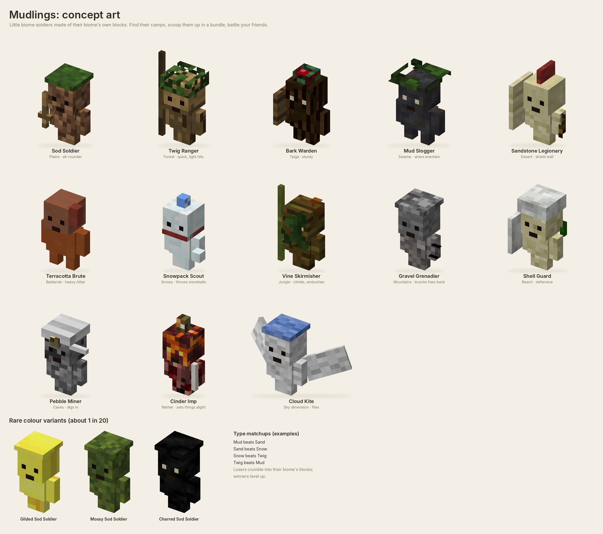
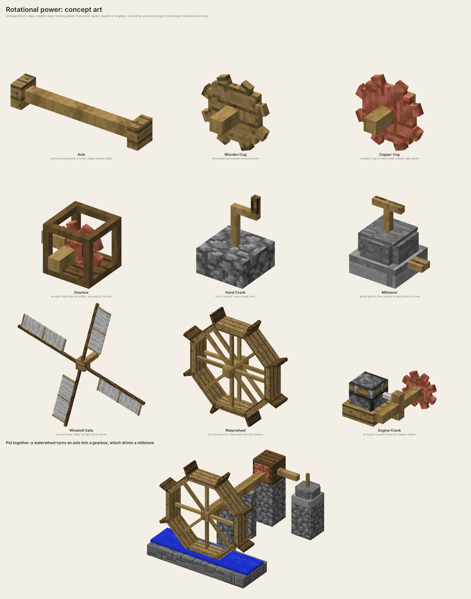

# RyanCraft roadmap

Ideas queued for later, roughly grouped. Struck-through items are built; see [docs/CHANGELOG.md](docs/CHANGELOG.md).

## Next up
- ~~**Seasons**~~ (built in 1.3.0). Still to do: antler shedding in late winter.
- ~~**Thirst bar**~~ (built in 1.4.0): drink from water or bottles; some foods give a little water.
- **Deep layer below deepslate** (Alex's Caves style): regular, toxic, frozen, underground-overworld and deep-dark caverns.
- ~~**Fishing loop**~~ (built): catch-and-measure fish, trophies, personal bests in the Angler's Logbook, fish plaques.
- **Squirrels that really climb**: run up trunks, cling sideways and hang upside down on bark.
- ~~**Old-school spawn eggs**~~ (built): redo the egg icons to look like the classic two-tone spotted eggs, cleaner and calmer.
- **Chipmunk eyes**: they're tiny, so the eyes may need to move to the sides of the head; check in game.

## Wildlife
**Deer family**
- ~~**Elk** and **moose**~~ (built)
- ~~**Black-tailed deer** (western coastal forests).~~ (built)
- ~~**Pronghorn**~~ (built)

**Predators and big game**
- ~~**Grizzly bear**~~ (built)
- **Elephants**, including big **war elephants** you can saddle and armour.
- ~~**Bobcat**~~ (built)
- ~~**Alligator** (swamps)~~ (built)

**Birds**
- ~~**Bald eagle** and **golden eagle**~~ (built)
- ~~**Hawks** (the ambience already has hawk calls to hook into)~~ (built)
- ~~**Vultures** circling high over open country~~ (built)

**Ocean**
- ~~**Whales**~~ (built), each with its own behaviour: **orcas** (hunt in pods), **blue whales** (huge, slow, surface to breathe and spout).
- ~~**Sharks**~~ (built)
- ~~**Manta rays**~~ (built)
- **Schools of ocean fish** that move together.

~~**Batch 2 prototypes**~~ (all built; docs/prototypes_2.png): zebra (a horse variant), American bison, cougar, river otter, groundhog,
porcupine, eastern box turtle, timber rattlesnake, bullfrog, great horned owl, great blue heron, Canada goose,
ruby-throated hummingbird, pileated woodpecker, northern bobwhite, jellyfish.

**Small life**
- ~~**Butterflies**~~ (built): many species like the tropical fish (wing patterns x colours); 20 eastern species, see docs/butterflies_chart.png
- ~~**Fireflies**~~ (built): drifting over plains and through the woods on summer nights (the game only has the firefly bush).
- ~~**Chipmunks**~~ (built)

**Canines**
- ~~**Coyotes**~~ (built): a smaller, untameable wolf. Like the black bear, mostly leaves you alone unless you get close;
  travels in loose packs the way vanilla wolves do.

**Songbirds**
- ~~**Mourning doves**~~ (built), with their iconic soft cooing call (in the songbird family and the ambience).

## Hunting
- **Hunting gear**: game calls (turkey and deer calls that draw animals in), a tree stand, and the like.
- **No pelt system for now**: vanilla mobs stay as they are, and coyotes drop no leather. Deer give buckskin
  leather like a cow. Wolf and coyote pelts might come later, but it's unlikely.
- **Taxidermy** (later): stuff and mount animals; right-click a mount to cycle through poses, the way the
  copper golem statue switches poses.

## Cold and warm clothing
- **Cold in snowy biomes**: you get cold out in the snow without warm clothing.
- **Coats and capes** made from leather and wool. The trade-off: they take the armor slots, so to stay warm in the
  cold you take your armor off (no extra slot).

## Mudlings: biome soldiers you collect and battle
Our own take on the old Clay Soldiers idea, and the main "fight your friends" game.

**Finding them**
- Rare little squads of **mudlings** live in the wild, each biome with its own kind, made from that biome's stuff.
- **Rarity: relatively rare, never teeming, never unobtainable.** Mudlings only live at their camps (they don't
  spawn freely like animals). Aim for roughly one camp every 400-600 blocks of a given biome, generated as a small
  world structure, with 3-6 mudlings per camp. A camp doesn't refill once it's emptied, so building a squad
  means finding a few camps. Rare colour variants are about 1 in 20 mudlings.
- They patrol a tiny camp (a pebble fort, a twig lean-to) and scatter if you charge in, so sneaking and camo help.
- Rare colour variants (gilded, mossy, charred) to collect.

**Collecting**
- Scoop them up with a **vanilla bundle**: right-click a mudling and it goes in. A bundle holds **up to 4 mudlings**,
  the same as critters (no bundle holds more than 4 creatures). A squad is a few bundles' worth.
- Empty the bundle to deploy them; they hop out and form up.

**Biome mudlings, their style, and what they crumble into**

| Biome | Mudling | Style | Breaks down into |
|---|---|---|---|
| Plains | Sod soldier | All-rounder | Dirt, seeds, a flower |
| Forest | Twig ranger | Quick, light hits | Sticks, saplings, leaves |
| Taiga | Bark warden | Sturdy | Spruce bark, sweet berries |
| Swamp | Mud slogger | Slow, slows enemies | Mud, clay, lily pad |
| Desert | Sandstone legionary | Tough, shield wall | Sand, sandstone, dead bush |
| Badlands | Terracotta brute | Heavy hitter | Coloured terracotta |
| Snowy | Snowpack scout | Throws snowballs | Snow, ice, packed ice |
| Jungle | Vine skirmisher | Climbs, ambushes | Vines, cocoa beans, bamboo |
| Mountains | Gravel grenadier | Knocks foes back | Gravel, flint, stone |
| Ocean/beach | Shell guard | Defensive | Sand, shells, kelp |
| Caves | Pebble miner | Digs in | Cobblestone, coal, rare ore nugget |
| Nether | Cinder imp | Sets things alight | Netherrack, quartz, blaze powder |
| Sky dimension | Cloud kite | Flies | Sky materials |

**Battles**
- Set two armies down (on a battle table or anywhere) and they fight on their own while you watch.
- **Type matchups**: simple counters (mud beats sand, sand beats snow, snow beats twig, and so on).
- **Gear**: drop items on the table before a fight: leather for armour, a feather to glide, deer antler for a
  lance, a coonskin cap for morale.
- **Losers are toast**: they crumble into their biome's materials and are gone for good, so you go find more.
- **Winners level up**: survivors get tougher with each fight they win.

## Creature companions (maybe later)
If we still want them alongside mudlings: rare biome creatures you raise from an egg or befriend by feeding, that
follow you or live at a den, help out day to day (ore-sniffing, crop growth, fetching fish, light at night) and grow
through visible stages. The sparring side is covered by mudlings.

## Trees
**Built:** all 15 species, generating in the world and growing from saplings, each with log, wood, stripped log and
wood, planks, slab, stairs, fence, gate, door, trapdoor, button, pressure plate, leaves and sapling. Every tree rolls
its own height, limbs, crown size and occasional forks, so no two match, and crowns are built from limbs and leaf
clusters like vanilla's fancy oak. Still to do:
- **Signs, hanging signs and boats** for each species (these need their own wood type, entity and textures).
- ~~**Fall colours**~~ (built with seasons; all 14 broadleaf species).
- **Bare winter branches** (optional): leaves drop in winter and come back in spring.
- A rougher pass on the plate-style bark (sugar maple, redbud, buckeye).

**More trees (ideas)**
- **Redwood**: a 2x2-trunk giant like the jungle tree, but taller.
- **Olive** and **cypress**. (Sakura is covered by vanilla's cherry tree.)

**Berry bushes** out in the world (blackberry, raspberry, blueberry, elderberry, pawpaw...).

## Storage and inventory (ideas)
- **Backpack slot**: an extra inventory slot for a backpack.
- ~~**Clay pots, placeable bowls and buckets**~~ (built). Next: fired clay bowls and crocks, food spoilage.
- **Bowls**: a little smaller, and up to 4 per block (Vintage Story style).
- **Buckets**: can be placed diagonally (rotated 45 degrees).
- **Wooden bucket**: crafted from 3 planks and 1 iron ingot; holds water/milk and looks good set down in a house.
- **Special chests**: diamond, obsidian and lead glass.

## Blocks and backports
- **Concrete slabs and stairs**, backported from newer versions.
- **Shelf mushrooms** (the newer shelf fungus that grows on tree trunks).
- **Ruby and sapphire blocks**, alongside the emerald block.

## Villagers
- **Trade rework around emeralds, rubies and sapphires**: give the new gems a real use as currency tiers, each
  with a storage block.

## Food
- **Our own Farmer's Delight**: cooking, with plated foods you can set down as 3D meals.
- **More crops**: tomatoes, onions, cabbage, corn, peppers, rice, beans, squash and the like, growing with the
  seasons (some only in spring or summer).
- **More foods** to go with them: stews, soups, pies, roasts, sandwiches, plus dishes built on our game (venison,
  turkey, duck, fish fillets) and orchard fruit (cherries, walnuts).

## Weather
- **Dust storms**: rare, in deserts and badlands.

## Combat
Technology tops out around the early age of gunpowder: nothing past a muzzle-loader.
- **Old combat**: no attack cooldown, as in 1.8 and before.
- **Cannons**, with different shot:
  - **Round shot** (a lead or iron cannonball): long range, smashes blocks.
  - **Grapeshot** (a canvas bag of lead balls): a short-range spray, deadly to mobs, gentle on blocks.
  - **Chain shot** (two balls on a chain): spins through the air, tears through wood, sails and fences.
  - **Canister**: a tin of musket balls, a wider, weaker spray than grapeshot.
  - **Heated shot**: a ball heated in a furnace first, which sets wood alight where it lands.
  - **Explosive shell**: a hollow ball packed with gunpowder, which bursts on impact. The top tier, still nothing past a muzzle-loader.
- **Muskets**: very rudimentary guns, slow to load (powder, ball, ramrod), loud and smoky, inaccurate past close
  range. They fire lead balls.
- **Lead finally gets a use**: cast lead into musket balls and cannonballs.

## Rotational power (Vintage Story style, vanilla look)
Turning power from wind, water, muscle or engines, carried by axles and cogs to machines like the millstone.

- **Sources:**
  - **Hand crank:** early and slow.
  - **Waterwheel:** on a flowing river; stops when the river freezes in winter.
  - **Windmill sails:** on a tall tower; faster up high and in storms.
  - **Engine crank:** turns our engines' pulse into steady rotation.
- **Carrying it:** wooden axles in straight lines, wooden or copper cogs to turn corners, and an open-frame gearbox
  to split a shaft.
- **Machines:** the **millstone** first. It grinds grain into flour (for the cooking update), cobble into sand and
  bones into bone meal. Later: saw, trip hammer, bellows.

## Engineering ideas
A brainstorm of vanilla-plus machines (waterwheels, windmills, gearboxes, bellows, millstones, a shulker conveyor and
more) that run on the same engine pulse as everything else: see [docs/engineering_ideas.md](docs/engineering_ideas.md).

## Mobs: vanilla variants
- **Creeper variants**: biome-specific creepers, with the original still by far the most common.

## Power and automation (vanilla-friendly)
- Light-touch power generation and automation, not a full industrial tech tree. Redstone already covers a lot, so
  this would fill the gaps (simple generators, machines that fit the vanilla look).
- ~~**Pipes, engines and the Ender Terminal**~~ (built in 1.2.0). ~~**Tanks and pumps**~~ (glass tank, vat, screw
  pump and hand pump; built in 1.3.0).
- ~~**Ender Terminal GUI**~~: the search box is gone; a button in the corner sorts by name or by amount.
- **Force field generator**, fuelled by nether stars.
- **Cage upgrades**.

## Vehicles (primitive, Flan's-style)
- **A little biplane**: basically a boat with wings, fuelled with coal, with that primitive early-mod look.
- Other simple vehicles in the same style.

## A sky dimension (our own, not the Aether)
A dimension of floating islands above the clouds, in the spirit of the old Aether mod but with its own blocks,
creatures (no holystone, skyroot, moas or aerwhales), reached through the classic glowstone portal.
- **Getting there**: the classic Aether way: a frame of glowstone, lit by pouring a bucket of water into it.
- **The land**: floating islands of grassy meadow, cloud blocks you can stand on (some bouncy, some that drop you),
  updraft columns that carry you between islands, waterfalls pouring off the edges into nothing.
- **Great winged creatures**: big gliding sky rays that drift in flocks, huge soaring birds with nests on the high
  islands, maybe a rideable one you have to raise from an egg.
- **Its own materials**: sky-only wood and stone, a light ore for gear suited to falling and gliding.
- **Ambience**: high winds, the creak of floating rock, distant calls of the big birds.

## More dimensions (ideas)
Each one is reached through a portal built from vanilla blocks, has its own creatures and materials, and gives
something back to the overworld, so it's worth the trip. All in the same vanilla-plus look.
- **The Twilight Woods** (Twilight Forest in spirit, our own take): a forest stuck at dusk, with giant old-growth
  versions of our eastern trees, fireflies everywhere, owls and great elk, and hollow hills to dig into. You get
  there by stepping into a ring of flowers and mushrooms under a full moon. Brings back ancient seeds and giant wood.
- **The Far Lands**: a nostalgia world that generates like Alpha and Beta did, with overhangs, floating chunks, a
  cobblestone-and-mossy sky, and the old Far Lands wall at the edge. You get there through a portal framed in mossy
  cobblestone and bookshelves. Brings back old blocks like the nether reactor core, the glowing obsidian and the cyan rose.
- **The Frost Reach**: a frozen glacial world under an aurora, with mammoths (the elephants' woolly cousins),
  ice caves, frozen shipwrecks and a slow, pale sun. You get there through a portal of packed and blue ice, lit by
  powdered snow. Brings back mammoth wool, glacial blue ice and old frozen loot.
- **The Drowned Deep** isn't a separate dimension. It goes into the overworld's own deep oceans, once the world
  goes deeper: the deepest ocean floors drop away into **sunken islands**, the husks of drowned villages (sunken
  houses, a flooded bell tower, kelp-choked fields), shipwrecks wedged in canyons, whales overhead, and air pockets
  to find. It ties in with the deep cave layer below deepslate.
- **The Hollow Moon** (the actual moon, reached with jade):
  - **Getting there:** jade is a new rare ore, found deep in mountains and lush caves. Nine jade make a Block of Jade.
    Build a frame of jade blocks, light it with an eye of ender under a full moon, and step through.
  - **The land:**
    - low gravity (big floaty jumps, slow falls)
    - pale moon-dust plains and craters
    - glassy craters where meteors hit
    - silvery moon-tree groves and chalky cliffs
    - the real Earth hanging huge in a black sky, drawn Minecraft-style: blocky blue oceans, green and tan
      continents, white cloud bands, slowly turning and lit from one side like the moon is in ours
  - **Creatures:**
    - **Moon rabbits:** long-eared, silvery, and they hop very high. They're shy, and you can tame them with moon
      herbs.
    - **Dust drifters:** jellyfish-like things that float over the craters.
    - **Crater crabs:** they hide in moon dust and pinch.
    - **Lantern moths:** they glow and come to light.
    - **Hollow walkers:** quiet stone figures from an old moon people, who wake if you take from their ruins.
  - **Things to do:**
    - Mine moonstone (a light building stone) and moon dust, a light material for gliding gear, slow-fall
      boots and lanterns.
    - Explore the ruined jade temples of the old moon people, which hold the boss arena, loot and lore.
    - Watch meteor showers at "night" and gather the meteorite iron they drop (a strong, rare metal).
    - Grow moon herbs and bake moon cakes (food, and the rabbit's favourite).
  - **The new thing it unlocks** (as shulkers gave us shulker boxes): **moonstone gravity.** Moonstone dust
    from the Hollow Walkers, refined in the Moon Mortar, makes **Gravity Wells**: blocks that set a low-gravity
    field around them back on Earth. That means floaty jumps, slow falls and items that drift instead of drop, for
    sky bridges, safe drops, jump pads, low-gravity arenas and parkour. Nothing else gives it.
  - **The boss: the Great Moon Rabbit.** A giant rabbit that pounds a mortar and pestle in the heart of the
    jade temple, as in the old moon-rabbit legends. It leaps around the arena:
    - Ground slams that throw you up in the low gravity.
    - It summons moon-rabbit kits.
    - It throws glowing rice-cake bombs.
    - At half health it goes into a frenzy.
    - Beat it for the **Moon Mortar** (a workstation that grinds moon herbs into potions of slow falling and
      jump), its **jade crown**, and a **rideable moon-rabbit mount** egg.
- **Dreams**: sleep in a special bed and wake up in a strange, shifting dream world (floating furniture, bright
  colours, odd gravity) for one night; wake up in your bed at dawn with whatever you carried out. A nightmare
  version for anyone who sleeps hungry or thirsty.

## Ores and the world underground (very Tekkit)
- **Salt**, found in **salt caves**
- **Aluminum, tin, zinc, lead, silver, uranium**
- **Silver and lead ages**: tool and gear tiers built on the new metals.
- **Ruby and sapphire**

## NPCs beyond villagers
Built around **places you find** rather than a populated world: camps generate as their own structures, with
their people living there, so they work in any normal world.
- **Bandit camps**: hostile, silent (no chat), with tents, a campfire, loot to take. You fight your way in.
- **Tribal camps**: their own settlements and people.
- **Wanderers**: now and then a couple of these NPCs walking around in a village, so the world feels less empty.
- If tribes are based on real Native American peoples, they should be done with care and respect: neutral or
  friendly people with their own camps and trade, not enemies or set dressing. (Could also be original,
  fictional groups instead.)
