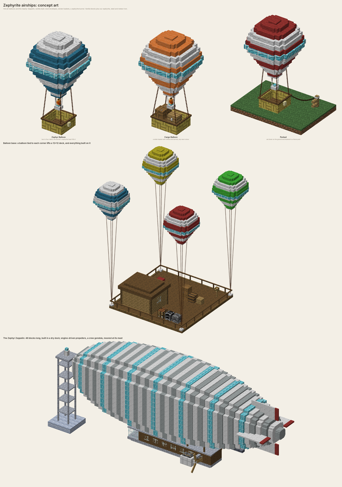
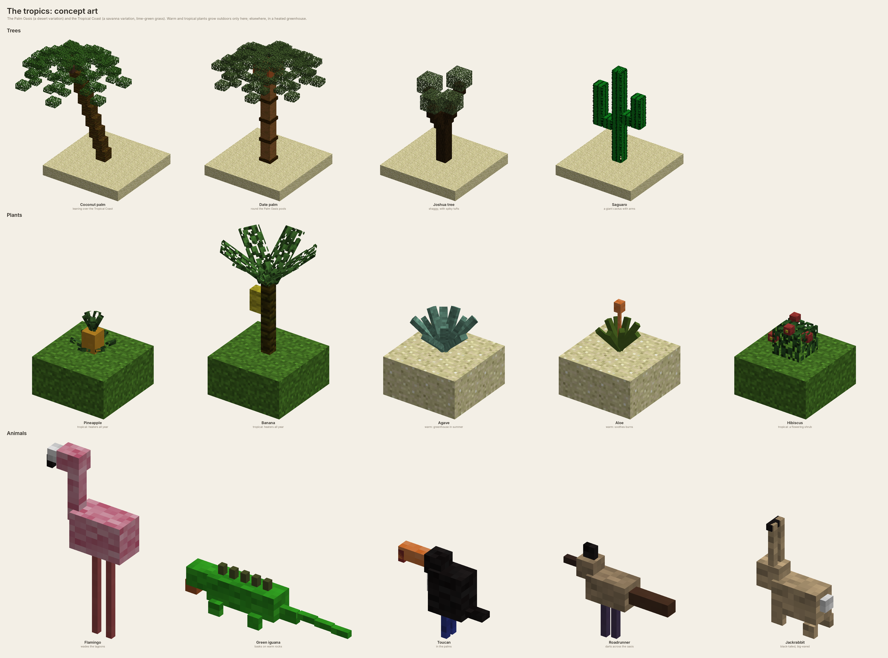
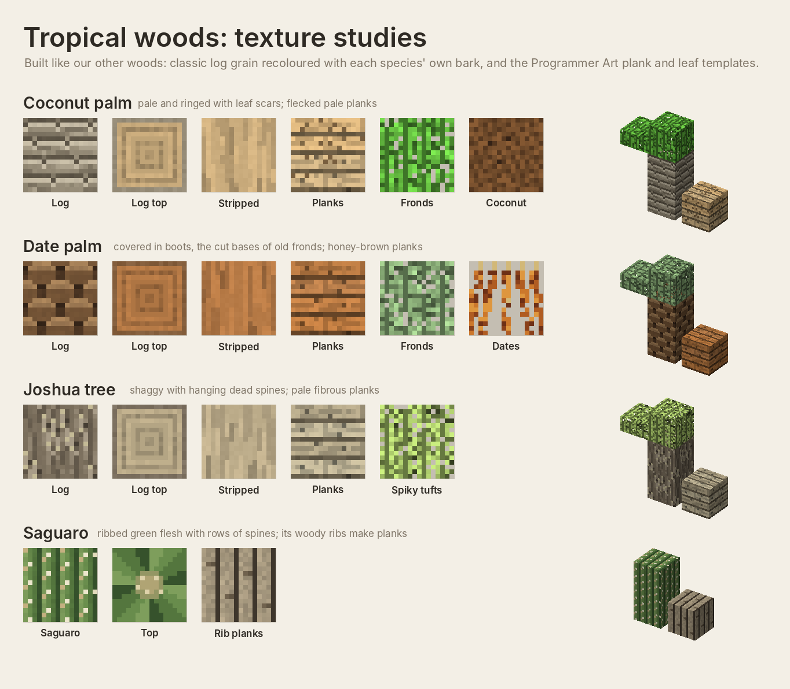
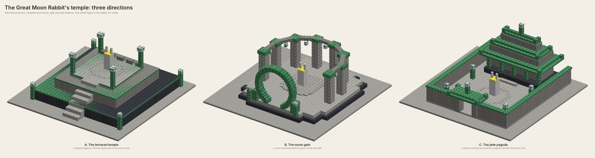

# Concept ideas

Bigger ideas worked out in discussion, not yet scheduled. The [roadmap](../ROADMAP.md) points here; once something is
built it moves to the [changelog](CHANGELOG.md).

## The compass
The wonder of Tekkit and the hand-made feel of Vintage Story, without going wild, and always with character:
- **Tekkit's wonder**: machines that do something you couldn't do before, and the joy of building them up into
  something bigger. Power you make, carry and store.
- **Vintage Story's grounding**: things work the way you'd expect them to in the real world. Resin drips from a
  tapped tree, beer ferments over days, a windmill needs wind, a waterwheel stops when the river freezes.
- **Not too wild**: no turning dirt into diamonds, no flying in creative mode with a suit, no tech tree you need a
  wiki to climb. Each block does one clear job. Early industrial is the ceiling (coal, steam, copper wire, brass),
  not lasers and fusion.
- **Character**: everything should look like it belongs in vanilla, and have a little personality: the porter
  golem's wind-up key, wool balloons, a crackly phonograph, streetlights coming on at dusk.

## Zephyrite and airships
Today zephyrite makes iron-tier gear (the boots stop fall damage; the full set glides on sneak), the glider and the
zephyr vent. More reasons to mine it:

- **Zephyrite windmill**: an upgraded, superior version of the default windmill (see Rotational power in the [roadmap](../ROADMAP.md)). It turns
  faster and more steadily, needs less height and open air, and keeps turning in light winds.
- **Weathervane**: a decorative block that swings with the wind and gives a redstone signal ahead of rain, thunder or
  a dust storm.
- **Wind chimes**: hang them under a block; they ring softly in the breeze and louder in storms.
- **Zephyr fan**: a sideways zephyr vent. It blows items, mobs and players along a line: item sorting, mob farms,
  launching yourself across a gap.
- **Renewable wind charges**: zephyrite and gunpowder make wind charges (and so a farmable way to the Potion of Air).
- **Zephyrite hot air balloon**: a slow, steady way to travel, in the spirit of the happy ghast.
  - Room for several riders (one steers, the others sit in the basket).
  - Variants: a passenger basket, and a cargo basket with chest storage.
  - Lands on the ground and can be leashed to a fence post so it stays put when you leave it.
  - Rises and sinks on its burner; drifts a little with the wind, faster in storms and in the Skylands.
  - **Lifting a mobile base**: tie a balloon to each corner of a 12×12 deck and the four lift it together. The
    deck carries what's built on it (a little mobile operations centre: chests, a crafting table, a bed, a furnace)
    and can be set down and picked up again. Needs a "moving blocks" system (the deck stored inside an entity while
    it flies), so it's the big step after the single balloon.
- **Zephyr Zeppelin**: the endgame airship, huge and hard to make, and built your way. The core is the zephyrite
  envelope with its engines and a helm; below it you build whatever you like (decks, cabins, a cargo hold, a
  bridge, workshops, gardens) out of ordinary blocks, and it all flies together. Up to **2048 blocks** can ride
  along; past that it's too heavy to lift off. The heavier it gets, the slower it climbs and the more fuel it burns.
  Built in a **dry dock** (a frame you build on the ground, which shows the outline and the block count as you go)
  from late-game materials: blocks of zephyrite for lift, a meteor-iron keel, steel, engines and a nether star for
  its heart. Moors at a mooring mast and can cross between the overworld and the Skylands. (Needs the same "moving
  blocks" system as the balloon base, scaled up.)
- **Zephyr charm**: carry it and it saves you from a fall that would kill you: a gust breaks the fall just before you
  hit the ground, and if you drop into the void it lifts you back up to safety. Hard to make but not unreasonable:
  a block of zephyrite in the middle, ringed with gold ingots and phantom membranes. One use, like a totem: it crumbles
  into dust when it saves you.
- **Zephyr propeller**: an upgrade for the biplane (see Vehicles in the [roadmap](../ROADMAP.md)) once it's built: faster and steadier in the air.

## Electricity: early industrial
A little past medieval: Tekkit-style power, but vanilla-looking.

- **Rubber tree**: its own wood family; a tree tap on the trunk drips resin, smelted into rubber (wire insulation,
  belts, seals).
- **Wires**: copper and silver (silver carries more, with less loss), each bare or insulated with rubber. Bare wire
  shocks anything that touches it.
- **One power ladder** (napkin notes): when electricity arrives, the **redstone engine** becomes the **electric engine**
  (renamed, so existing ones carry over): a wire feeds it the power, and a redstone signal switches it on and off. So the engines plug into the new system rather
  than competing with it. The
  **Stirling engine** stays the fuel engine, burning coal, and grows up into a **steam engine**. Alongside it a
  **coal generator** burns coal straight into electricity, and building a steam engine takes one of its parts (its
  boiler), so the steam engine comes after the generator. Rotation (cranks, water, wind) turns dynamos; dynamos
  and generators make electricity; electricity drives the engines and machines.
  Rotation also drives simple machinery straight off the shaft, Vintage Story style, no electricity needed: the
  **millstone** (grain to flour, cobble to gravel to sand, bones to bone meal), a **saw** (logs to planks, more of
  them than by hand), a **trip hammer** (crushing ore, beating out metal plates), a **bellows** (stokes a forge or
  blast furnace), a **butter churn**, a **spinning wheel** (string and wool), a **grain thresher**, a **water lift**
  (a chain of buckets raising water) and a **lathe** (turned wood parts: spindles, wheels, bowls).
- **Making power**:
  - **Dynamo**: turns an engine, or rotational power, into electricity.
  - **Generator**: burns fuel for power.
  - **Water turbine** on a flowing river, and **windmills** (the zephyrite windmill the strong one).
  - **Solar mirror**: a silver mirror behind glass, turned to the sun; works by day.
  - **Coal boiler** and steam turbine (maybe).
- **Storing it**: **lead-acid battery banks**.
- **Machines**:
  - **Crusher**: grinds ore into dust, two ingots per ore.
  - **Electric furnace**.
  - **Electric heater**: warms you in cold places and keeps a greenhouse growing through the winter.
- **Light**:
  - **Electric lamps** that light a much wider area than a torch or lantern.
  - **Streetlights**: tall lamp posts that light a whole street.
  (Vanilla light stops at 15 blocks, so the wide reach would come from hidden light sources the lamp spreads out.)
- **Frames and motors** (RedPower's, but vanilla-looking): a far better way to move things than slime blocks.
  **Frames** (a wooden lattice with brass corners) stick to each other and to the blocks they touch; an electric
  **motor** pushes the whole framed structure one block at a time, carrying whatever's built on it. Lifts,
  drawbridges, sliding doors, moving walls, and contraptions that crawl across the land. Runs on electricity. The
  same moving-blocks system the balloon base and the zeppelin need.
- **Block breaker** and **block placer**: electric machines that mine the block in front of them and place blocks
  from their inventory. Paired with frames and motors they make tunnel bores, bridge builders and farm harvesters.
- **Metals at work**:
  - **Bronze** (copper and tin): a tool and armour tier between stone and iron, and sturdy machine casings.
  - **Brass** (copper and zinc): gears and fittings for the machines.
  - **Brass golem porter**: a clockwork helper that follows you around carrying a chest's worth of your things, a
    walking backpack. A big wind-up key sticks out of its back, just for looks: it never needs winding.
  - **Tin cans**: can food so it keeps, and carry it on long trips.
  - **Aluminum**: light, strong frames for the biplane.
  - **Uranium glass**: glass with a little uranium in it, glowing a soft green (a real thing, like old vaseline glass).

## Brewing
IndustrialCraft's booze barrel was a Tekkit favourite; ours would sit with the cooking pot and the seasonal crops.
- **Hops**: a climbing crop that grows up a trellis (fence or rope), harvested in late summer.
- **The brew**: fill a **keg** (a barrel on its side, with a tap) with water, wheat and hops, and seal it. It
  ferments over a few in-game days; leave it longer and it gets stronger and better. Tap it into a **mug**.
- **More brews**: **mead** from honey, **cider** from apples, and **wine** from sweet berries or grapes (if we add
  grapevines).
- **Drinking**: quenches thirst, and a mug or two gives a little courage (a touch of strength or resistance). Too
  many and the screen starts to sway.
- **Tavern**: a village building with a keg and a bartender villager who trades brews.

## The meteor iron armoury
Star-metal for the best arms in the game, on top of the netherite-strength tools and armour it already makes:
- **Meteor iron greatsword**: a big two-handed blade, slower than a sword but hitting harder with a wide sweep.
- **Meteor iron horse armour**: the strongest barding for horses (and a version for pegasi that leaves the wings
  free).
- **Meteor iron cannon**: the best cannon, reloading faster and firing further than the iron one.
- **Meteor iron musket**: a smoothbore like the existing musket, but better: harder hitting, a little more
  accurate and quicker to reload.
- **Meteor iron spear**: the best of vanilla's spears, with a longer reach on the lunge.
- **Meteor iron crossbow**: star-metal limbs that draw faster and shoot harder.
- **Meteor iron anvil**: never chips or breaks, however much you use it.
- **Lodestone magnet**: meteorites are iron-nickel and magnetic, so a small meteor iron charm pulls dropped items and
  experience toward you from a few blocks away.
- **War elephant armour**: in every tier the horse armour comes in (leather, copper, iron, gold, diamond, netherite), with meteor iron
  the strongest.

## Keeping food: perishable food (a difficulty option)
An optional mode, off by default, where food spoils over time, which gives all of these a real job:
- **Spoilage**: fresh food slowly goes stale and then rotten (rotten flesh, or compost for the farm). Cooked food
  lasts longer than raw; dried, salted and smoked food much longer.
- **Icehouse**: in winter, cut blocks of ice from frozen lakes and pack them into a sawdust-lined icehouse; food
  stored inside keeps for much longer, and the ice slowly melts through the summer.
- **Electric fridge**: the industrial answer, running on power. Keeps food fresh as long as it's powered.
- **Tin cans**: canned food never spoils.
- **Kegs and barrels**: brews and spirits don't spoil; they get better with age.

## Seasonal villages
Very Stardew: villages change with the year.
- **Seasonal trades**: villagers sell what's in season (seeds in spring, fruit in summer, pumpkins and preserves in
  autumn, warm clothes in winter).
- **Festivals and decorations**: lanterns and pumpkins for a harvest festival in late autumn, garlands and lights in
  winter, flowers in spring. Unloaded villages are handled lazily: when a village's chunks load, it checks the
  season and swaps its decorations then, so it always looks right when you arrive.

## The naturalist's journal
A field journal that fills in as you explore, like the Angler's Logbook for every creature:
- **Spotting**: every creature you see (close up, or through a spyglass) is logged with a sketch, where and when you
  first saw it, and notes on its habits. Rare forms (the black swan, the cinnamon bear, a trophy buck) get their own
  entries.
- **Butterfly collection**: right-click a butterfly to collect it into the journal's pinned-specimen pages.
- **Never lost**: the data belongs to you, not the book; a new journal shows everything you'd recorded.

## Distilling and bourbon
A full distillation system, built on brewing:
- **Copper still**: boil a fermented mash (corn, wheat, rye, apples, sugar cane) into spirits: **bourbon**,
  whiskey, apple brandy, rum, moonshine.
- **Charred barrels**: char the inside of an oak barrel with fire, fill it and let it age. Bourbon darkens and
  improves over in-game weeks; the longer it sits, the better it sells.
- **Rickhouse**: a big barrel warehouse where the seasons speed or slow the ageing, like in Kentucky.

## The early camera
- **Daguerreotype camera**: take a picture of what you're looking at, and it develops onto a **silver plate** you can
  frame and hang like a painting. A real early-industrial process, and another use for silver.

## The lunar rover
- An **aluminum** frame, **rubber** tyres and a **battery**: a little buggy for crossing the moon's plains, with
  room for a passenger and a few chests. Bounces happily in the low gravity.

## The Skylands boss
- The islands need a dungeon and a guardian at the top of their progression, as the Great Moon Rabbit is for the
  moon. To brainstorm: something of wind and sky (a storm-roc, a cloud giant, a living weathervane).

## Life in the Abyss
The Abyss has caverns but no creatures of its own yet. Real Kentucky cave life (Mammoth Cave) and things that glow:
- **Eyeless cavefish** (for the fishing logbook), **cave salamanders**, **cave crickets** chirping in the dark,
  **pale cave crayfish**.
- **Glowing creatures**: glow-worms hanging their lights from the cavern ceilings, luminous moths, softly shining
  fish in the underground pools, glowing beetles in the Toxic Caves, blue-glowing ice shrimp in the Frozen Caverns.

## Greenhouse physics
Greenhouses already let crops grow out of season; this makes them a real build with real warmth.
- **A proper greenhouse**: an enclosed space with a glass roof (and mostly glass walls), checked when you're inside.
  Step in and the corner of the screen says **Greenhouse**, with its **warmth out of 10**.
- **Where warmth comes from**: the sun through the glass (strong in summer, weak in winter, nothing at night),
  minus the cold outside (the biome and the season); a little from torches, lanterns, campfires and furnaces inside;
  a lot from **electric heaters** (see Electricity).
- **Hardy and tender plants**: every crop has a warmth it needs. Hardy ones (cabbage, onions, wheat) get through
  winter in a plain greenhouse; tender ones (tomatoes, peppers, squash, rice) need it kept warm, which in deep winter
  means heaters. Too cold and they stop growing, and a hard frost can kill them.
- **Leaks and drafts**: a gap in the glass, an open door or a missing pane lets the warmth out, so it pays to build
  it tight (and maybe a double door).

## Hardiness zones and the tropics
Every plant has a **hardiness zone**: how warm it needs to be. It grows outdoors only where the climate suits it, and
anywhere else only in a greenhouse warm enough for it (see Greenhouse physics).

| Zone | Grows outdoors in | Elsewhere |
|---|---|---|
| **Hardy** (wheat, cabbage, onions, the berries) | Anywhere but frozen biomes | A plain greenhouse gets it through winter |
| **Temperate** (tomatoes, peppers, corn, squash) | Temperate and warm biomes, in season | A greenhouse in spring to autumn; heaters in winter |
| **Warm** (citrus, dates, agave, aloe) | Deserts, savannas, the tropics | A greenhouse in summer; heaters the rest of the year |
| **Tropical** (pineapple, banana, coconut, coffee, hibiscus) | The tropics only | A greenhouse with heaters, all year round |

**New biomes**: the **Palm Oasis**, a desert variation (pale sand, clear oasis pools ringed with date palms, agave
and aloe, the odd Joshua tree and saguaro), and the **Tropical Coast**, a savanna variation (lush lime-green grass,
white beaches, coconut palms leaning out over warm lagoons, banana groves, pineapples and hibiscus).

**Trees**: the coconut palm (leaning, with coconuts), the date palm (tall and straight, with hanging clusters of
dates), the Joshua tree (shaggy, branching, spiky tufts) and the saguaro (a giant cactus with arms). The palms get
full wood sets.

**Plants**: pineapple, banana, coconut, agave (for agave nectar), aloe (soothes burns), citrus (oranges, lemons,
limes), coffee and hibiscus. Bring them home and grow them in the zone they need.

**Animals**: flamingos wading in the lagoons, iguanas basking on the rocks, toucans in the palms, roadrunners
darting across the oasis sand, and black-tailed jackrabbits.

## Islands: Alpha Island and the tropical islands
Two kinds of island out in the ocean, found the way mushroom islands are, but a little more often.
- **Alpha Island**: a decently large island that looks the way the world did in Alpha. The grass and leaves take the
  bright, saturated Alpha green (no biome tinting), the oaks grow as the old round blobs of leaves on short trunks,
  there's no tall grass, just the old roses and dandelions, and the beaches are sand and gravel with clay in the
  shallows. Only the old animals live there (pigs, cows, sheep and chickens). Rarer than most biomes, but you'll come
  across one if you sail: a bit more common than mushroom islands. (A smaller cousin of the Far Lands idea on the
  roadmap: a taste of the old world, in this one.)
- **Tropical islands**: small sandy islets out in warm oceans, a few coconut palms leaning over a ring of white sand,
  a shallow lagoon, coral and tropical fish, and flamingos and iguanas (see Hardiness zones and the tropics). Good
  places to find tropical plants to take home.

## Built from these pages
- **The jade temple** (built in 1.9.2): the three temple concepts below were combined into the terraced temple with a
  moon gate and a pagoda hall.

## The Deep Freeze, our way (the Frozen Caverns, deepened)
Mojang's coming Deep Freeze update (26.4: ice caves, icicles, brittle ice over crevasses, a frozen zombie) points at
the same place as our Frozen Caverns. Our own take, so it sits beside theirs rather than copying it:
- **Icicles** hanging from the ice spires and the cavern roof, growing slowly in the cold; they snap and fall when
  something walks beneath (like pointed dripstone), and can be broken off for a frosty drink of water.
- **Thin ice**: a brittle crust over hidden crevasses that cracks under your feet and gives way after a moment, so a
  careful walker can step back; a slow-falling sheet of snow drifts down after it.
- **Permafrost**: frozen abyssal stone with ice veins, its own block set (bricks, polished, tiles, chiseled), and a
  pale blue **rime brick** set from packed ice and snow.
- **The Rimebound**: miners who lost their way down here long ago, now slow, ice-crusted undead that breathe frost
  (a few seconds of slowness) and shatter into ice and old mining gear; and **frost moths** glowing pale blue.
- **Cold**: down here, without warm clothing or a heater, you slowly freeze (ties into the warm-clothing idea).

## Rift capsules: spatial storage, the ender way
Our own take on AE2's spatial storage and its "holodeck", built on the Ender Terminal's ender theme, with no AE2:
- **Rift pylons**: ender-crystal posts you set at the corners of a cube (small 4x4x4, medium 8x8x8, large 16x16x16).
  When they line up, a faint purple frame of light shows the space they hold.
- **Rift capsule**: an ender item, one per size (eye of ender, obsidian and shards of the matching size). Put it in
  the **rift controller** and pulse it: everything inside the frame (blocks, chests and their contents, machines,
  even the animals) swaps places with whatever the capsule holds. An empty capsule takes the space and leaves air; a
  full one puts its space back and takes yours. The capsule shows what it holds ("Workshop, 8x8x8").
- **The holodeck**: keep a shelf of capsules (a farm, a forge, a garden, a guest room) and swap them into one rift
  room as you need them, the room loading in and out of existence around you with a ripple of ender particles.
- **How it works**: each capsule's space lives in a hidden "pocket" dimension (one pocket per capsule), so nothing
  stored can be lost, and the swap is a copy between the two. It shares its moving-blocks machinery with frames and
  motors and the airships, so building one helps build the others.
- **Cost**: each swap uses ender pearls (or, once electricity arrives, a big draw of power); bigger capsules cost more.
