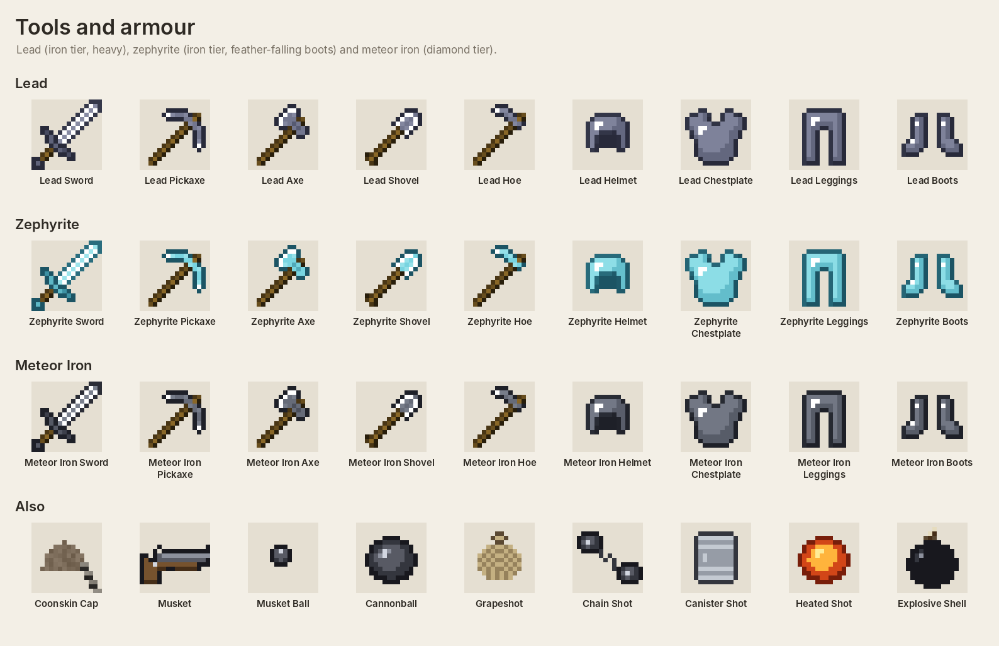

[← Wiki home](Home.md)

# Combat

## Old combat

There's no attack cooldown: swing as fast as you click, like before 1.9. Spears keep their own animation. Turn it
off with `oldCombat` in the [config](Settings.md).

## Cannons

**Recipe:** 3 iron blocks over log, gunpowder, log, over 2 wooden slabs.

Load it in order: **gunpowder, then a shot**. Light it with flint and steel or a fire charge, and after a short fuse it
fires where the barrel points. Then it has to cool and be swabbed: 8 seconds before it takes powder again.

Climb on with an empty hand to aim it. The barrel follows your look, and you can load and light it from the seat.
Left alone, it holds its aim. Break it with a few hits to pick it up.

| Shot | Recipe | Effect |
|---|---|---|
| **Cannonball** (2) | 4 iron or lead ingots in a square | Bursts like weak TNT |
| **Grapeshot** (2) | 8 musket balls around wool | Bursts into a spread of lead balls |
| **Chain shot** | Cannonball + chain + cannonball | Tears through wood, leaves, fences and wool, slowing as it goes |
| **Canister shot** (2) | 8 musket balls around a tin ingot | Bursts into lead balls |
| **Heated shot** | Smelt a cannonball | Bursts like a cannonball and starts fires |
| **Explosive shell** | Cannonball + 2 gunpowder + string | A bigger explosion |

## Muskets

**Recipe:** iron barrel with flint and a wooden stock (`  I /  IF / PS ` with planks and a stick).

Hold use to load it, about three seconds: one gunpowder and one **musket ball** (4 from a lead ingot). Then use to fire:
a loud crack, a cloud of smoke and a hard-hitting ball that wanders off line past close range.

## Armour and tools

| Material | Tier | Special |
|---|---|---|
| Lead | Iron | Harder to enchant. Heavy armour that shrugs off a little knockback |
| Zephyrite | Iron | A little easier to enchant. Boots stop fall damage, and a full set glides while you sneak |
| Meteor iron | Diamond | Made on the moon |
| Coonskin cap | Leather | Leather and a raccoon tail |
