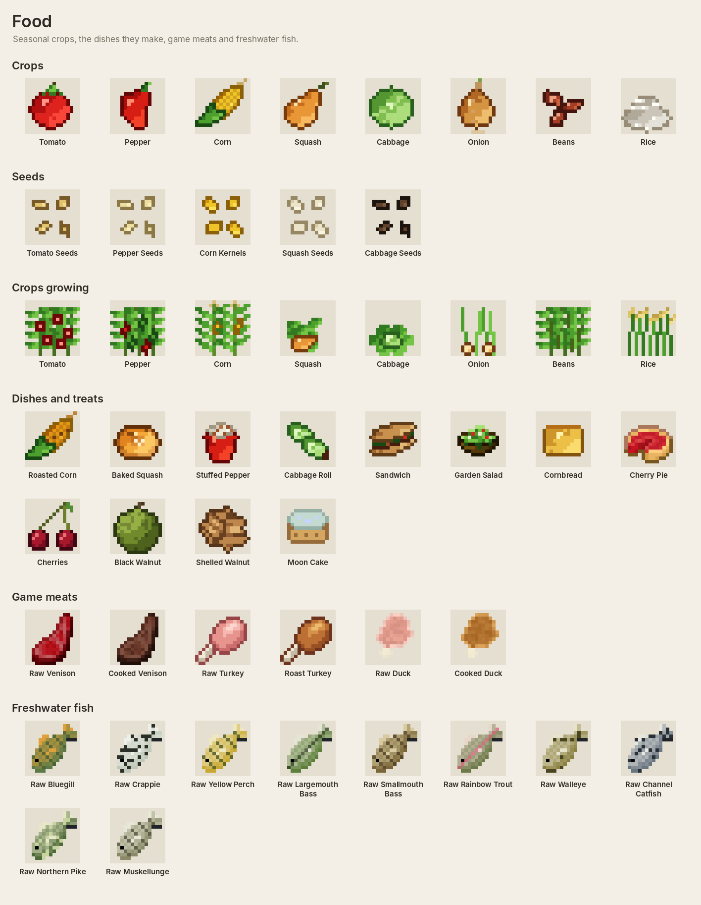
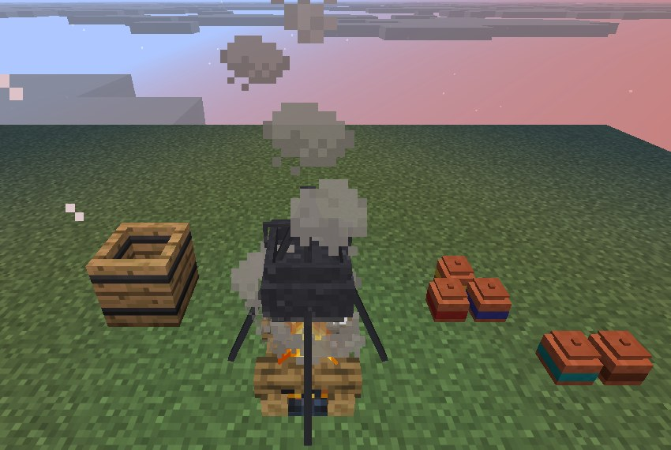
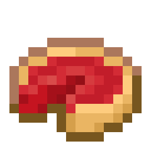

[← Wiki home](Home.md)

# Cooking and Farming

## The cooking pot

**Recipe:** iron ingots in a U shape (`I I / I I / III`).

Set the pot over a **campfire** and it stands on an iron tripod. Between two solid blocks (a fireplace) it hangs from
a crane bar. Use it on the campfire itself and it sits right in the fire.

1. **Pour in water or milk.**
2. **Add up to six ingredients.** Sneak with an empty hand to take back the last thing you put in. An empty hand on
   its own tells you what's inside.
3. **Bring it to the boil.** The pot shows its colour and bubbles, then simmers into portions of a meal named for its
   main ingredient: a stew, soup, chowder or porridge.
4. **Ladle it out with bowls.** Meals can be set down as bowls, up to four to a block.

When the pot sits in the fire, it keeps the campfire's fuel burning. Feed it logs or other fuel by right-clicking,
put it out with a shovel and relight it with flint and steel. Sneak with an empty hand on an empty pot to lift it
off.

## Campfires burn fuel

Campfires have a furnace-style menu. Put in logs, planks or any fuel. The fire burns through it and goes out when it
runs dry, and the menu shows how long is left.

## Seasonal crops

Each crop only grows in its own [seasons](Seasons.md) outdoors in temperate biomes. Under a roof (a greenhouse) it
grows all year except winter. Seeds first come from **breaking grass**, and after that from the produce itself.

| Crop | Seasons | Planted from |
|---|---|---|
| Tomato | Summer | Tomato seeds |
| Pepper | Summer | Pepper seeds |
| Corn | Summer | Corn seeds |
| Squash | Summer, autumn | Squash seeds |
| Cabbage | Spring, autumn | Cabbage seeds |
| Onion | Spring | The onion itself |
| Beans | Spring, summer | The beans themselves |
| Rice | Summer | The rice itself |

Crafting produce gives seeds back (1 tomato → 2 tomato seeds, and so on).

## Dishes

| Dish | Made from |
|---|---|
| Roasted corn | Corn, cooked in a furnace, smoker or campfire |
| Baked squash | Squash, cooked |
| Stuffed pepper | Pepper + rice + any cooked meat |
| Cabbage rolls (2) | Cabbage + rice + any cooked meat |
| Sandwich | Bread + any cooked meat + cabbage or tomato |
| Garden salad | Bowl + cabbage + tomato + onion |
| Cornbread (2) | 3 corn + egg |
| Cherry pie | 3 cherries + sugar + egg |
| Moon cake | 2 moon herbs + 2 wheat + sugar + egg (see [The Moon](Moon.md)) |

All dishes are shapeless recipes. Venison, raw duck, raw turkey and every game fish cook in a furnace, smoker or
campfire.

## Clay pots and bowls

Shape clay into an **unfired clay pot** (`C C / CCC`) and fire it in a furnace. Pots stack and each one holds its
own little store. Right-click to open one, or right-click holding food to drop it straight in. Broken pots keep
their contents. See [Storage](Storage.md).

## Pemmican

The trail food of the plains: dried bison pounded with fat and berries. Craft a **bison steak**, a **raw bison** and
**sweet berries** into three cakes of pemmican. Each one is small but very filling.
