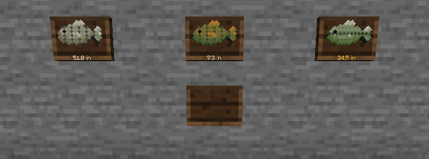

[← Wiki home](Home.md)

# Fishing

Rivers, lakes and swamps give RyanCraft's freshwater game fish (plus salmon). Oceans give the vanilla cod, salmon and
pufferfish.

## The fish

Bluegill · Crappie · Yellow perch · Largemouth bass · Smallmouth bass · Rainbow trout · Walleye · Channel catfish ·
Northern pike · Muskellunge

Catfish and walleye bite more after dark. Every fish can be cooked in a furnace, smoker or campfire, and live fish
can be caught in a bucket.

## Lengths, trophies and legends

Every catch has a real length, called out when you land it ("Largemouth Bass - 18.5 in").

- Most fish fall in their species' typical range (a bluegill is 4–9 in, a muskie 28–44 in).
- About **1 in 50** is a **trophy**, up to the real-world record. Trophies get a fanfare.
- About **1 in 1000** is a **legendary** fish, up to 15% past the record.
- A new personal best gets a note in chat.

## Showing off

- **Angler's Logbook** (book + any fish, shapeless): records your biggest fish of each species, with trophies
  starred.
- **Fish Plaque** (3 wooden slabs over slab, item frame, slab; makes 2): hang it on a wall and use a fish on it to
  mount it. Its length is engraved underneath, in gold for trophies. Use it with an empty hand to take the fish back.
