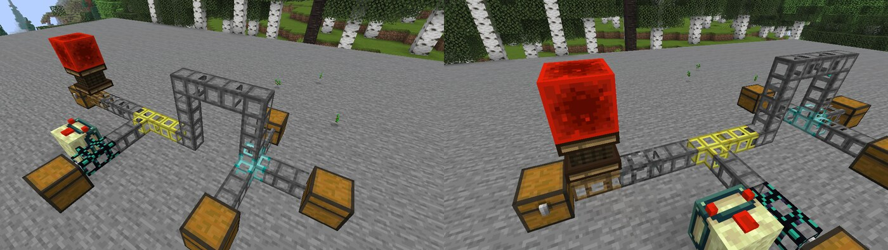
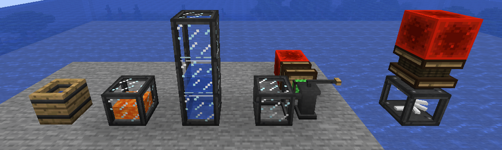
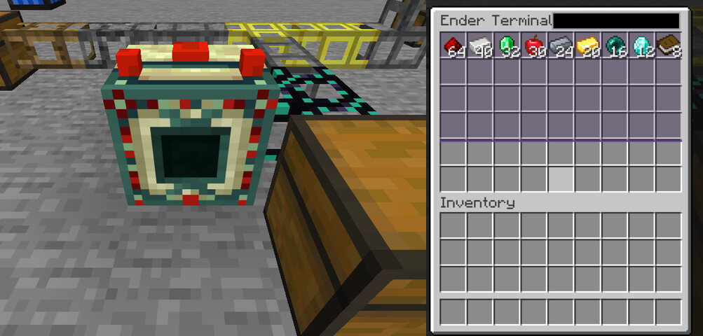

[← Wiki home](Home.md)

# Machines

Vanilla-friendly, BuildCraft-style pipes, engines and pumps. Items visibly travel the pipes. Use a **wrench**
(`I I / I / I` in iron) to turn machines.

## Pipes

Every pipe recipe is the material, glass, the material in a row, and makes 8.

| Pipe | Material | What it does |
|---|---|---|
| Wooden pipe | Planks | Pulls items out of the inventory it touches each time an engine pulses it |
| Cobblestone pipe | Cobblestone | Basic transport |
| Stone pipe | Stone | Basic transport, a little faster |
| Iron pipe | Iron | Sends everything out of one side. Turn it with a wrench |
| Golden pipe | Gold | Speeds items up, and they keep the speed for a while |
| Diamond pipe | Diamond | Sorts: set a filter for each side |
| Obsidian pipe | Obsidian | Sucks up items lying nearby |
| Ender pipe | Ender pearl | Put one against a chest and the Ender Terminal can reach into it, with no engine needed |
| Fluid pipe | Stone pipe + green dye | Carries water and lava |

## Engines

- **Redstone engine** (planks, glass, 2 redstone, a piston): runs while powered by redstone.
- **Stirling engine** (cobblestone, glass, furnace, 2 pistons): runs on fuel alone and glows while lit.

Engines warm up slowly, and several engines can drive one machine. A running engine pointed at a blast furnace
makes [steel](Ores.md#steel).

## Fluids

| Block | Recipe | What it does |
|---|---|---|
| **Glass tank** | Iron at the corners, glass on the sides | Holds 16 buckets. Tanks stack seamlessly, and fluid falls into the tank below |
| **Vat** | Planks with an iron ingot | Iron-hooped, holds 8 buckets, collects rain, fills bottles |
| **Archimedes screw pump** | Iron, redstone, bucket and tank | Engine-driven. Drains a pool from the outside in, farthest and edge sources first. Only feeds a fluid pipe that leads to a tank |
| **Hand pump** | Iron ingots and a bucket | Draws groundwater from up to 16 blocks down and pours it from its spout into a tank, pipe or held bucket. Works by hand or by engine |

## Ender Terminal

**Recipe:** comparator over redstone, an **end portal frame**, redstone, over an ender pipe.

Hook it to a pipe network and it sees every chest, barrel and pot along the pipes. Ask for an item and it's pulled
out and sent down the pipes to you. Put items in and they travel off to wherever there's room. A button sorts by
name or by amount, and a scroll bar appears when the list gets long.

**The catch**: end portal frames only drop when mined with a **Silk Touch diamond or netherite pickaxe**. Taking
one breaks that stronghold's portal for good, and Eyes of Ender skip it and lead to the next one. Operators can
see where the eyes lead with `/stronghold`.

## Force field generator and gravity well

These are built from moon materials. See [The Moon](Moon.md).
