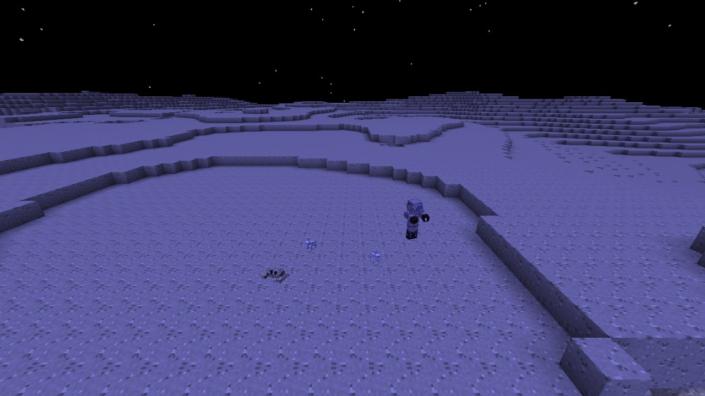
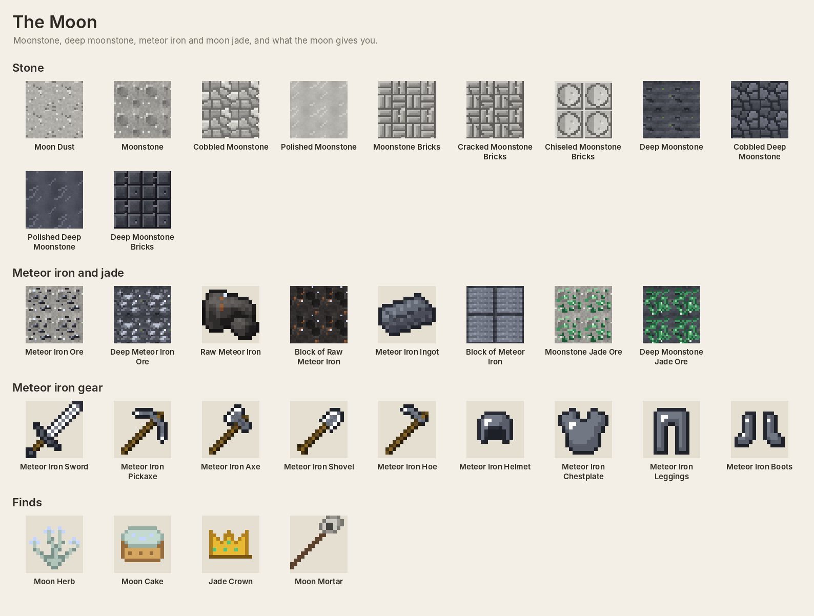
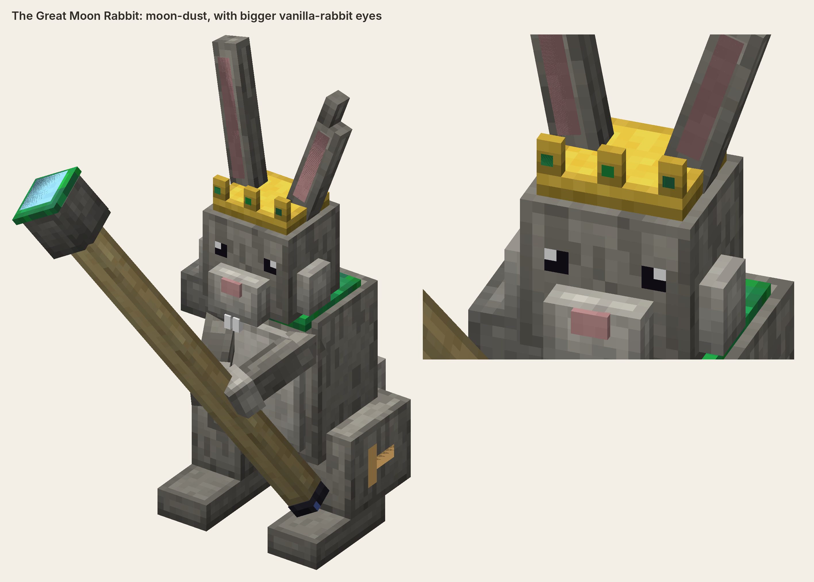

[← Wiki home](Home.md)

# The Moon

Low gravity, no air, falling meteors, and a boss guarding the way home.

## Getting there

Build a nether-portal-shaped frame from **Blocks of Jade** (9 jade each) and light it with an **eye of ender**. Jade
ore is found in mountains and lush caves.

**The trip is one way.** Every jade portal lands you at the same spot on the moon, with no portal back, and a jade
frame won't light there. A short walk away stands the **jade temple** of the **Great Moon Rabbit**: defeat it and a
portal home opens at the back of the temple. It stays open for later trips and takes you back to the jade portal
you went up through (or builds one there if it's gone).

**Pack for it:** Potions of Air, food, good armour and building blocks.

## Surviving

- **Low gravity**: floaty jumps, slow falls, gentle landings, and items that drift instead of dropping. You can drop
  about 10 blocks without getting hurt.
- **No air**: you run out of breath like underwater. Ways to breathe:
  - **Potion of Air**: brew an awkward potion with a **wind charge**, and add redstone for a longer one.
  - **Force field generator** (meteor iron, glass, a diamond block, a redstone block): holds a sphere of 8, 12 or 16
    blocks (sneak + right-click to change) where you can breathe and meteors are caught at the edge. Feed it a nether
    star for a long charge, or a block of meteor iron for a shorter one. Bigger fields burn fuel faster, and every
    meteor stopped costs a little. Redstone pauses it.
- **Meteors** fall from the black sky. Build under a force field.

## The land

Rolling dusty plains under a starry black sky. **Moon dust** falls like sand, and **moonstone** comes cobbled, polished,
brick, cracked and chiseled, with stairs, slabs and walls. Below about y=32 is **deep moonstone**. Caves, old lava
tubes and ravines run through the stone down to bedrock at y=0.

**Meteor iron** ore glows faintly in the caves. Smelt it into ingots for netherite-strength tools and armour.

**Gravity well** (moon dust, meteor iron and chiseled moonstone bricks): takes moon gravity anywhere, even Earth.
Redstone switches it off.

## Moon life

| Creature | Drops | Notes |
|---|---|---|
| Moon rabbit | Rabbit hide | |
| Crater crab | Moon dust | |
| Dust drifter | Glowstone dust | |
| Lantern moth | | A glowing moon butterfly |
| Lost spaceman | Rotten flesh, tinted glass | Comes in several suit colours |
| **Great Moon Rabbit** | Jade crown, Moon Mortar, meteor iron | The boss. It summons angry moon rabbits |

**Moon herbs** grow in the dust and can be potted. Bake them into **moon cakes** (2 moon herbs + 2 wheat + sugar +
egg).

## The Great Moon Rabbit

The temple's guardian: a towering moon rabbit with a jade crown and the **Moon Mortar** staff. Watch its moves:

- **Staff strike**: up and over the shoulder, then down on you. Hard knockback.
- **Ground slam**: it roars, raises the staff high and crouches. **Jump when you see the wind-up**: the slam sends a
  shockwave across the floor that hurts and throws anyone standing on it.
- **Meteor bat**: from further away, it swings the staff sideways like a bat and knocks a baby meteor at you.
- **Summon**: it holds the staff up with its ears pricked, the jade top glowing, and a pack of angry moon rabbits (one
  in four a brute) pops up around it.
- **Eclipse**: below half health its fur goes dark, its eyes blaze violet and a halo of light turns behind its head.
  It hops faster and uses every move more often, batting several meteors at a time.

When it falls, it drops its staff, loses its crown and topples over, and the portal home opens.

