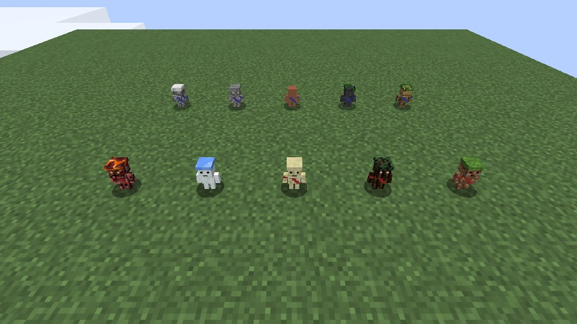

[← Wiki home](Home.md)

# Mudlings

Mudlings are little biome soldiers made of their biome's own stuff. Wild ones live at their camps and scatter when
a player comes near.

## Finding them

Mudling **camps** are rare: a small ring of the biome's own blocks with a flag post in the middle, guarded by 3–6
mudlings. Camps never refill, so each one is a find.

## The kinds

| Kind | Biome | Health | Bite | Camp built of |
|---|---|---|---|---|
| Sod | Plains and anywhere else | 8 | 2 | Coarse dirt |
| Twig | Forests | 6 | 1.5 | Oak planks |
| Bark | Taiga | 12 | 2 | Spruce logs |
| Mud | Swamps, Sycamore Bottoms | 9 | 1.5 | Mud |
| Sandstone | Desert | 11 | 2 | Cut sandstone |
| Terracotta | Badlands | 10 | 3 | Terracotta |
| Snowpack | Snowy biomes | 6 | 1 | Packed ice |
| Vine | Jungle | 7 | 2 | Mossy cobblestone |
| Gravel | Mountains | 9 | 2 | Gravel |
| Shell | Beaches | 10 | 1.5 | Smooth sandstone |
| Pebble | Stony shores, caves | 10 | 2 | Cobblestone |
| Cinder | The Nether | 7 | 2 | Blackstone |
| Kite | The Skylands | 6 | 1.5 | Skystone |

Snowpack scouts keep their distance and throw snowballs. Kites strike from above. About 1 in 20 mudlings has a rare
colouring: **gilded**, **mossy** or **charred**.

## Collecting

Scoop mudlings up in a **bundle** (4 to a bundle) and set them down wherever you like. Creative players can use
the per-kind spawn eggs.

## Every mudling is different

Each mudling is born with its own **health, attack and speed**, rolled a little above or below its kind's (up to 15%
either way, most near the middle). **Sneak and use an empty hand** on one to look it over: it tells you its health
and attack, how each roll compares with its kind's (weak, fair, average, good or great) and how many wins it has.
Worth knowing before you pick your champions.

## Teams and battles

**Dye a mudling** to put it on that colour's team. Mudlings of different teams find each other and fight on their
own.

- **Matchups**: each kind beats two or three others and hits half again as hard against them. Some examples:
  mud beats sandstone and cinder, snowpack beats twig and cinder, cinder beats twig, bark, vine and kite, and gravel
  beats sandstone, terracotta and kite.
- **The loser crumbles** into its biome's materials.
- **The winner levels up**: every victory gives it a little more health and bite, up to five victories.
