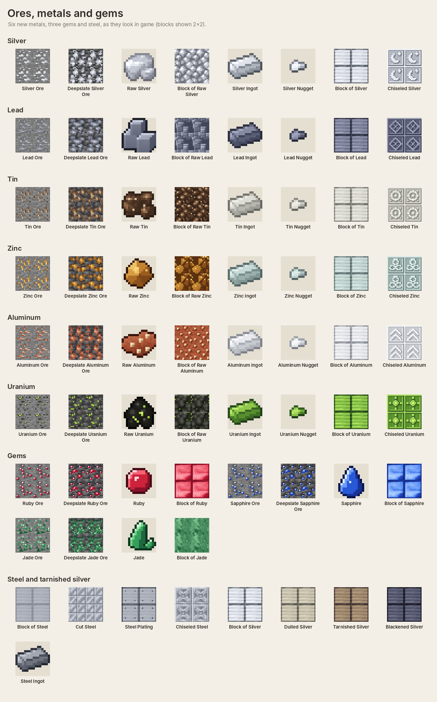
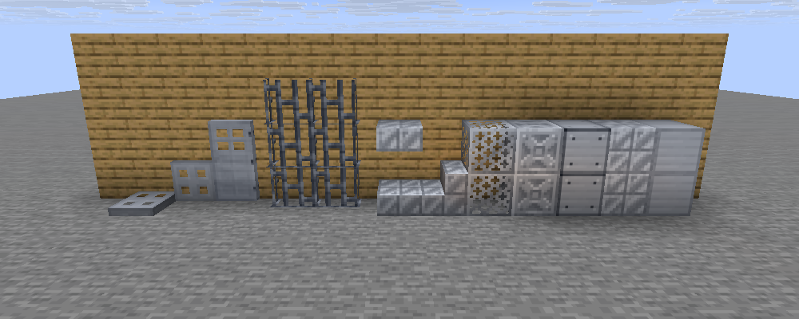

[← Wiki home](Home.md)

# Ores, Metals and Gems

## Metals

Each metal has stone and deepslate ore, raw metal, an ingot, a nugget, a block of raw metal, a block and a chiseled
block. Smelt or blast the raw metal (or the ore) into ingots. Every metal block works in a beacon.

| Metal | Depth | Used for |
|---|---|---|
| Silver | Deep (y −48 to 32) | Decoration. Silver **tarnishes** through four stages; wax it with honeycomb to keep it shiny |
| Lead | y −32 to 64 | Lead tools and armour, leaded glass, musket balls, cannonballs, the lead glass chest |
| Tin | y 0 to 96 | Canister shot |
| Zinc | y −16 to 64 | |
| Aluminum | y 32 to 112 | |
| Uranium | Very deep (y −64 to −16), rare | |

**Leaded glass**: 8 glass around a lead ingot makes 8. It comes in 17 colours and two patterns (diamond and
square).

## Steel

Point a running [engine](Machines.md) at a **blast furnace** and it works like a bellows. While it's stoked and
burning fuel, iron ingots turn into **steel ingots** (20 seconds each). Steel makes a Block of Steel, Cut Steel (with
stairs and slab), Steel Plating, Chiseled Steel, a see-through Steel Grate, Steel Bars, and a redstone Steel Door
and Trapdoor. Most can be cut on the stonecutter.

## Gems

| Gem | Found | Uses |
|---|---|---|
| **Ruby** | Hot, dry lands: desert, badlands, savanna | Currency for desert and savanna villagers, beacon payment, block |
| **Sapphire** | Snowy and frozen lands | Currency for snowy villagers, beacon payment, block |
| **Jade** | Mountains and lush caves (and the moon) | Jade bricks, and the frame of the [moon portal](Moon.md) |

**Regional currency**: villagers in deserts and savannas trade in rubies, snowy villagers in sapphires, and the rest
in emeralds. The **Money Changer** villager (job site: the **Coin Scale**, made from 4 gold ingots over 3 wooden
slabs) swaps one currency for another, five for four.

Lapis gets bricks and chiseled blocks too.

## Moon and sky ores

- **Meteor iron**: found in the moon's caves, where it glows faintly. Its gear matches netherite. See
  [The Moon](Moon.md).
- **Zephyrite**: found in the Skylands. Its gear is on par with iron, and the boots stop fall damage. See
  [The Skylands](Skylands.md).
