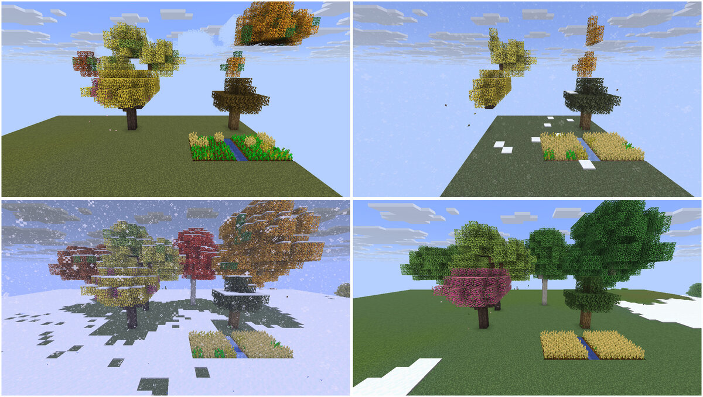
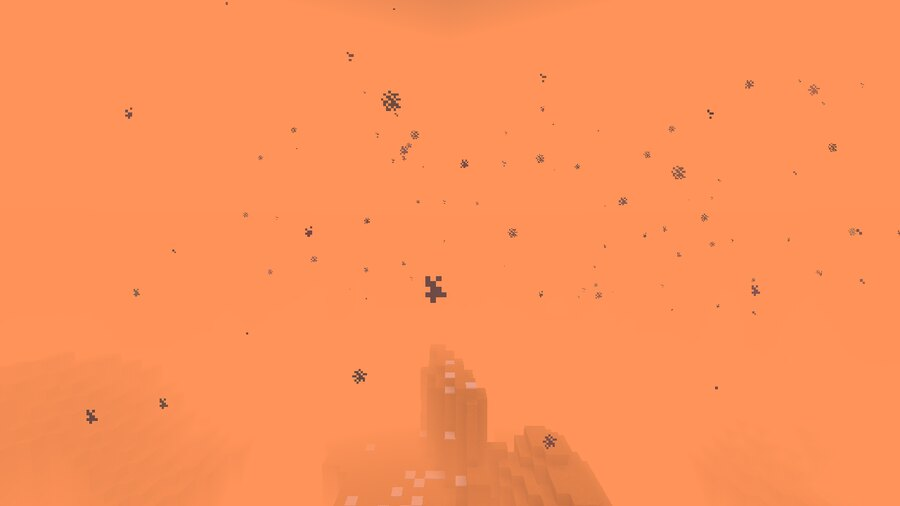

[← Wiki home](Home.md)

# Seasons, Thirst and Weather

## Seasons

The year has twelve parts: early, mid and late spring, summer, autumn and winter. Each part lasts 8 days, and a
new world starts in spring.

- **Winter**: temperate biomes get snow and ponds freeze. Crops stall unless they're under a roof.
- **Spring**: the snow melts a layer at a time. Redbud and dogwood blossom.
- **Autumn**: all fourteen broadleaf species turn their autumn colours. In late autumn and winter they go a dull
  grey-brown, and the cedar stays evergreen.
- Grass and foliage colours shift through the year.
- [Crops](Cooking.md#seasonal-crops) each have their own growing seasons.
- The Skylands and the moon have no seasons.

**Season Calendar** (3 paper + a clock): use it to see the date, or hang it on a wall like a painting (use it on the
side of a block). On the wall its page shows the part of the year (a picture for the season, and early, mid or late
marked along the bottom) and turns by itself as the seasons pass; use it there to read the date. Operators can use `/season` and `/season set <season>
[early|mid|late]`.

## Thirst

A row of water droplets sits over the hunger bar.

- **It drains** a little faster than hunger, and faster when you sprint, stand in the sun in hot biomes (desert,
  badlands, savanna), are in the Nether, or are caught in a dust storm.
- **Drinking**: use water with an empty hand to sip (+1 droplet), or drink a water bottle, which lasts three sips.
  Milk, stews, honey, melons, berries, apples, carrots, beetroot, pies and cherries help a little.
- **Hydration** works like saturation: drinks and juicy foods top it up, and it's used up before the bar drops.
- **Running low**: at 3 droplets or fewer you can't sprint. With none left you stop healing and take damage, like
  starving.
- It refills by itself on Peaceful and doesn't drain in Creative.
- `/thirst` shows yours, and operators can use `/thirst set <0-20>`. Turn it off with `thirst` in the
  [config](Settings.md).

## Dust storms

Deserts and badlands get rare dust storms, usually 5–12 minutes long, every 5–10 days. They bring sandy fog (rust-red
over the badlands) that closes in to about 40 blocks, blowing dust, a howling wind and faster thirst. Operators can
use `/weather duststorm [duration]`, and `/weather clear` ends one.

## Ambience

RyanCraft plays its own original ambient sounds by biome, time and weather: birdsong, crickets, wind, rain on
leaves. On warm nights, fireflies drift over grass. Both can be turned down or off in the [config](Settings.md).
