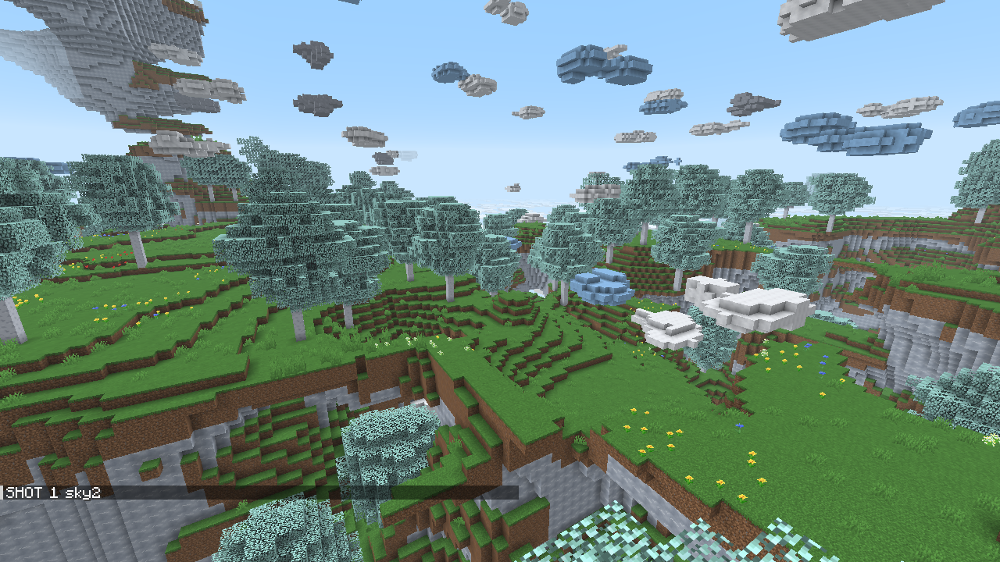
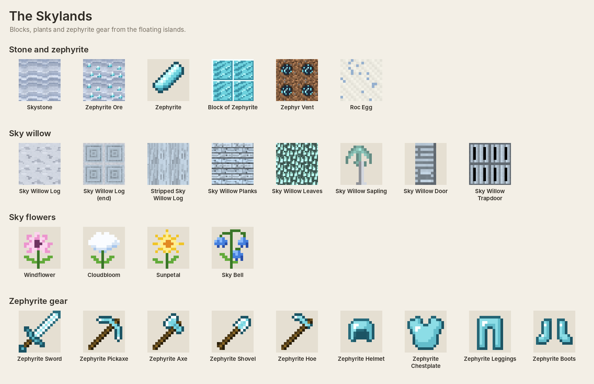
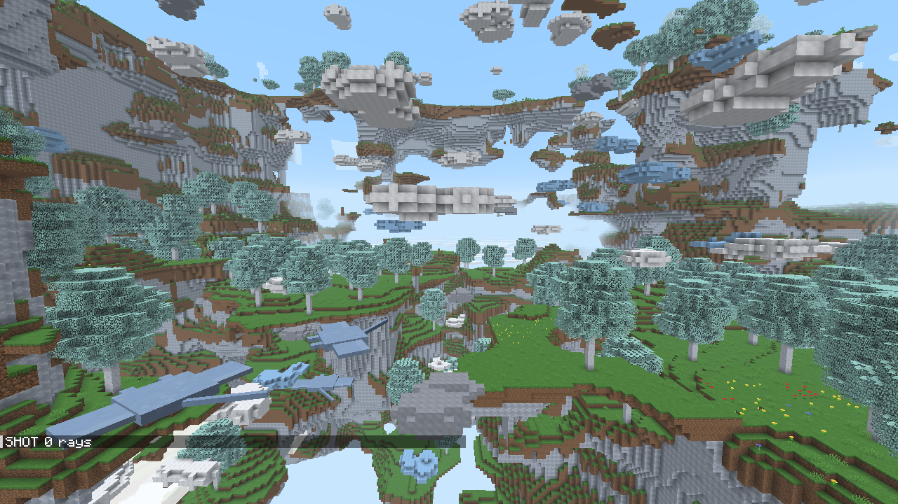

[← Wiki home](Home.md)

# The Skylands

Floating islands above the clouds, RyanCraft's own take on the old Aether.

## Getting there

Build a frame of **glowstone** in a nether portal's shape, then **pour water into it** to light it. The far end finds a
portal within 32 blocks, or builds one on an island or a little skystone ledge.

**Falling off** an island isn't the end: drop below the islands and you fall out of the sky into the overworld,
with Slow Falling to land safely.

## The land

- **Skystone**, banded like cloud strata, and the **sky willow** with its full wood set.
- **Springs and waterfalls** pouring off the island edges, and clouds drifting just below.
- **Zephyr vents**: openings in the grass that blow you upward. Craft your own from 4 skystone around a zephyrite.
- **Sky flowers**: windflower, cloudbloom, sunpetal and sky bell.
- Its own high-wind ambience. No seasons.

## Zephyrite

Mined from Skylands ore. Zephyrite tools and armour are iron-tier and a little easier to enchant. The **boots stop
fall damage**, and a **full set lets you glide** down slowly while you hold sneak.

## Animals

- **Pegasus**: white or grey. Tame, saddle and armour it like a horse. It jumps twice as high and glides instead
  of falling, so it never takes fall damage. Breed it with a horse for a winged foal in any horse coat.
- **Sky roc**: a huge pale bird that circles the islands and nests on the highest ones. Leave it be and it leaves
  you be. Strike it and it strikes back hard.
- **Cloud sheep**: woolly sheep of the islands. Drops mutton.
- **Sky ray**: glides through the air. Drops phantom membrane.

## Raising a roc

1. Find a **roc nest** on a high island and take an egg with **Silk Touch**.
2. Place it. It cracks a little at a time and hatches a chick.
3. **Feed the chick mutton** until it trusts you. It's then yours.
4. When it's grown, **saddle it and ride**. It flies where you look while you hold forward, and hovers, sinking
   slowly, when you let go.

Feed a pair of rocs mutton to breed them.
