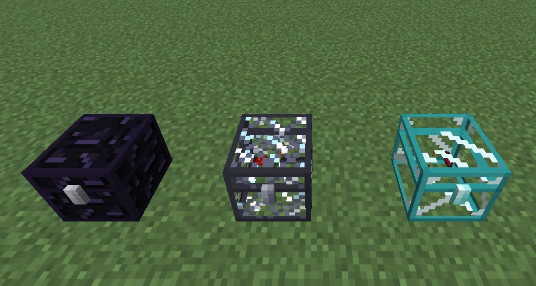
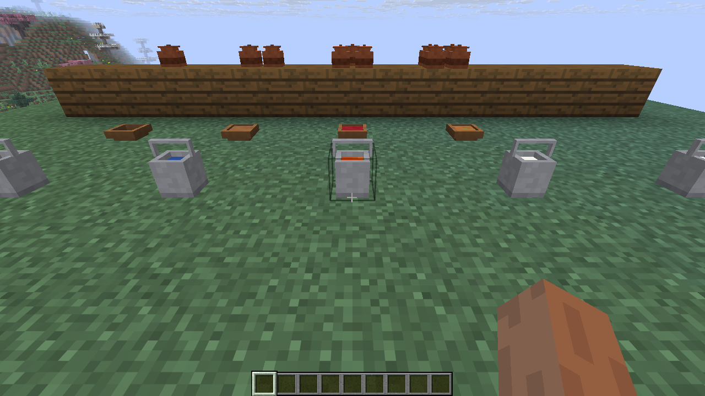

[← Wiki home](Home.md)

# Storage

## Special chests

| Chest | Recipe | What it does |
|---|---|---|
| **Obsidian chest** | 8 obsidian around a chest | Blast-proof |
| **Diamond chest** | Glass and diamonds, alternating around a chest | 54 slots and see-through, so you can see the items inside |
| **Lead glass chest** | Lead ingots and leaded glass, alternating around a chest | Shows the items inside |

## Clay pots

Shape clay into an **unfired clay pot** (`C C / CCC`) and fire it in a furnace. Pots stack on top of each other, and
each one holds its own small store. Right-click to open the one you're looking at, or right-click holding food to
drop it straight in. A broken pot drops as an item and keeps its contents.

## Placeable buckets

Sneak-right-click a bucket or a bowl on a surface to set it down, showing what's inside. Right-click it to pick it
up. A placed lava bucket gives off light.

## Bundles and cages

- **Bundles** carry up to 4 small creatures. See [Wildlife](Wildlife.md#catching-and-keeping-animals).
- **Bird cage** and **chipmunk cage** keep a live animal on display.

## Ender Terminal

One screen for every chest along your pipes. See [Machines](Machines.md#ender-terminal).
