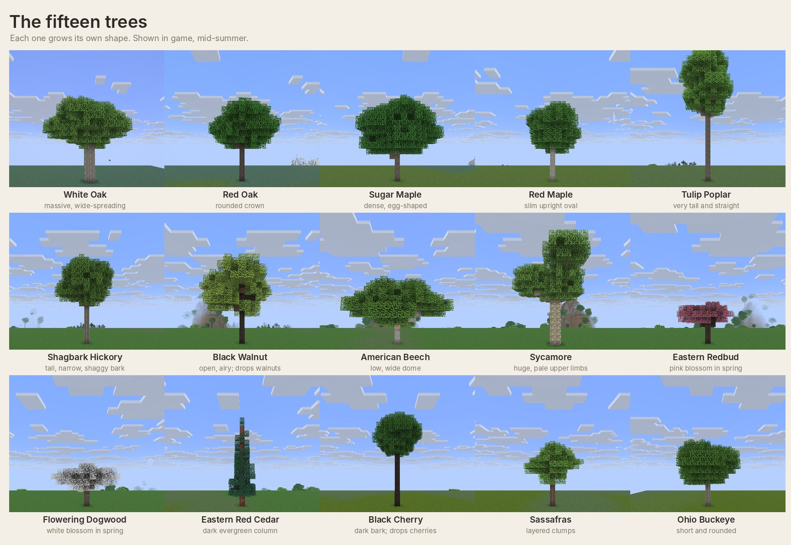
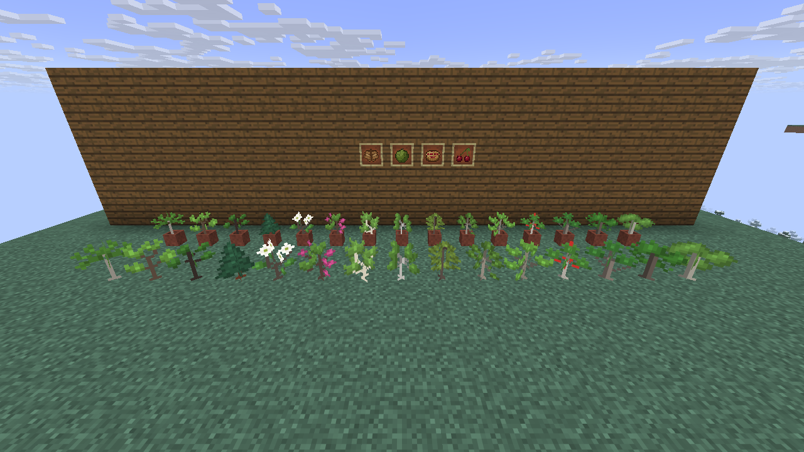

[← Wiki home](Home.md)

# Trees and Biomes

## The trees

Fifteen eastern US species grow in the overworld, and the sky willow grows in the [Skylands](Skylands.md):

American Beech · Black Cherry · Black Walnut · Eastern Red Cedar · Eastern Redbud · Flowering Dogwood · Ohio Buckeye ·
Red Maple · Red Oak · Sassafras · Shagbark Hickory · Sugar Maple · Sycamore · Tulip Poplar · White Oak · *Sky Willow*

Each has a **full wood set**: log, wood, stripped log and wood, planks, stairs, slab, fence, fence gate, door,
trapdoor, button, pressure plate, sign, leaves and sapling (saplings can be potted). Every tree has its own crown
shape and bark, and the broadleaf trees change colour through the [seasons](Seasons.md).

**Fruit and nuts**: black cherry trees drop cherries (bake a cherry pie), and black walnut trees drop black walnuts
(shell them for shelled walnuts). Squirrels drop walnuts sometimes too.

## Forest biomes

RyanCraft places its biomes itself (no TerraBlender needed):

| Biome | Trees |
|---|---|
| Oak-Hickory Woods | Oaks and shagbark hickory |
| Maple-Beech Forest | Sugar maple and beech |
| Tulip Poplar Cove | Tall tulip poplars |
| Buckeye Hollow | Ohio buckeye |
| Redbud-Dogwood Glade | Spring blossom |
| Cedar Glade | Eastern red cedar on open rock |
| Sycamore Bottoms | Sycamores along wet ground |
| Old Field | Open meadow growing back to woods |

The classic Beta biomes are back too: Seasonal Forest, Rainforest, Shrubland and Tundra. RyanCraft's trees don't grow
in deserts, badlands, savannas or jungles.

**Shelf mushrooms** (turkey tail and sulphur shelf) grow on old trunks, and turkey tail makes mushroom stew. The 1.2.5 **rose** is back: craft a rose bush into roses.
