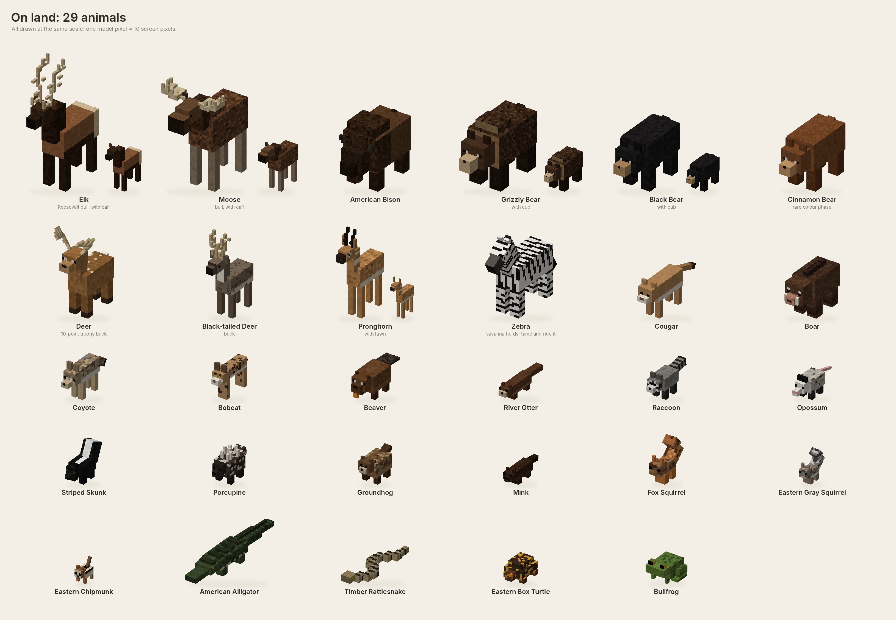
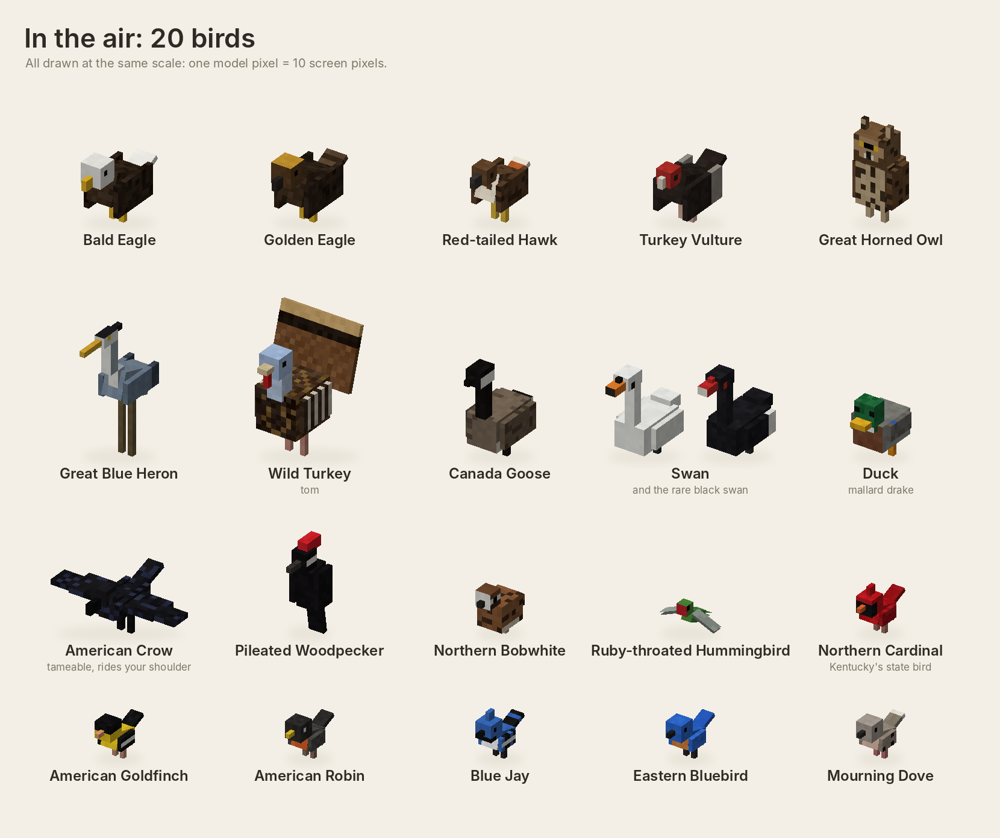
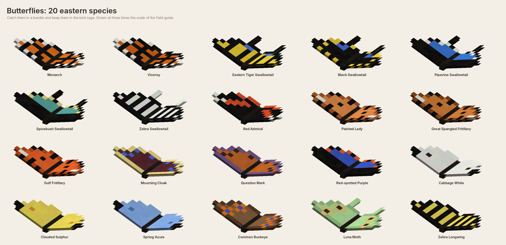
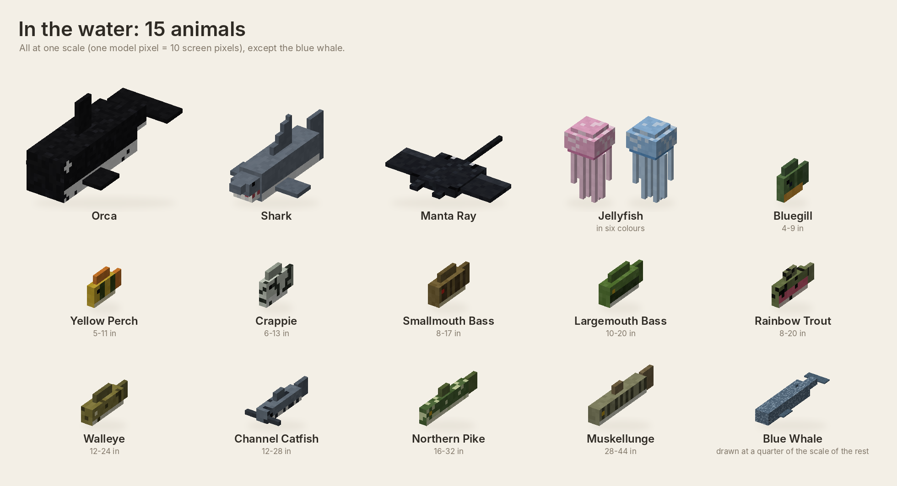
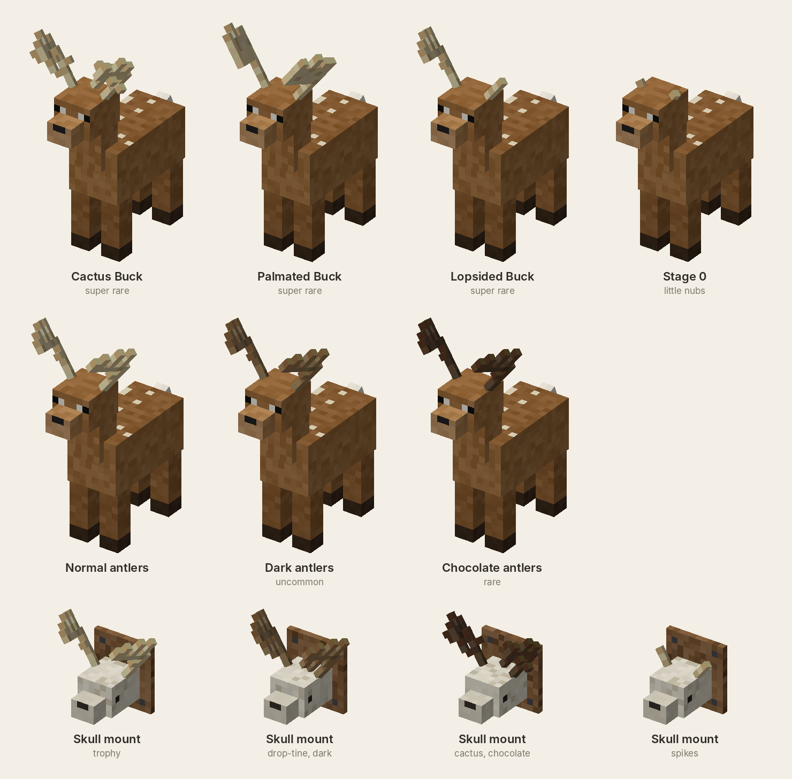
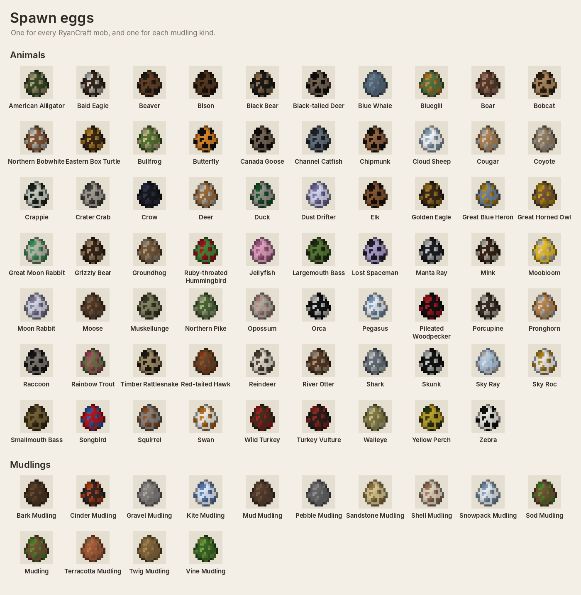

[← Wiki home](Home.md)

# Wildlife

RyanCraft fills the overworld with the animals of the eastern US forests, plus big game, birds of prey and ocean
life. All of them spawn naturally in fitting biomes, all have spawn eggs, and almost all breed on a sensible food.

## Land animals

| Animal | Where | Drops | Notes |
|---|---|---|---|
| Deer (white-tailed) | Forests, meadows, taiga | Venison, leather | Bucks grow antlers by age, with rare non-typical racks. Mount the skull as a trophy |
| Black-tailed deer | Taiga, windswept forests | Venison, leather | Staged antler racks |
| Elk | Meadows, taiga, windswept hills | Venison, leather | Staged antler racks |
| Moose | Taiga, snowy plains, swamps | Venison, leather | |
| Reindeer | Snowy plains, groves, tundra | Venison, leather | |
| Pronghorn | Plains, savanna, badlands | Venison, leather | |
| American bison | Plains, shrubland | Beef, leather | |
| Black bear | Forests, taiga | Leather, beef | Usually leaves you alone |
| Grizzly bear | Taiga, groves, windswept hills | Leather, beef | Attacks if it sees you |
| Cougar | Hills, taiga, badlands | Leather, bone | |
| Bobcat | Forests | Leather, string | |
| Coyote | Plains, savanna, forests | Bone | |
| Boar | Forests, taiga | Porkchop, leather | |
| Zebra | Savanna | Leather | Ride and armour it like a horse |
| Moobloom | Flower forests, meadows | Beef, leather | Milk it with a bowl for suspicious stew |
| Eastern gray squirrel | Forests | Rabbit hide, sometimes a black walnut | Climbs trees |
| Eastern chipmunk | Forests, taiga | Rabbit hide | |
| Raccoon | Forests, swamps | Raccoon tail | Make a coonskin cap |
| Striped skunk, opossum | Forests, plains | Rabbit hide (opossum: bone too) | |
| Groundhog | Plains, forests | Rabbit hide, sometimes a carrot | |
| Porcupine | Forests, taiga | Arrows (quills) | |
| Beaver | Rivers, swamps | Leather, sticks | Fights back |
| River otter, mink | Rivers, swamps | Rabbit hide or leather | |
| Eastern box turtle | Forests | Bone | |
| Timber rattlesnake | Hills, badlands, shrubland | Leather, spider eye | |
| Bullfrog | Swamps, rivers | Slime ball | |
| American alligator | Swamps | Leather | |

## Birds

- **Songbirds** (northern cardinal and friends), the **ruby-throated hummingbird** and the **pileated woodpecker**
  drop feathers.
- **Wild turkeys** roam in flocks and fight back. They drop raw turkey and feathers.
- **Ducks**, **Canada geese** and **northern bobwhite** drop raw duck and feathers. Geese fight back.
- **Mute swans** live on lakes, and a rare black swan turns up now and then.
- **Birds of prey**: bald eagle, golden eagle, red-tailed hawk, turkey vulture, great horned owl and great blue
  heron. They soar in wide circles and drop feathers.
- **American crow**: wary of strangers, but tame it with seeds. Breed crows with berries. It rides on your shoulder like a parrot, and sits when told to stay.
- **Butterflies and moths**: twenty-one species, from the monarch to the luna moth. They drop nothing, like bees.

## Ocean life

| Animal | Drops |
|---|---|
| Orca | Cod, bone |
| Blue whale | Cod, bones |
| Shark | Cod, bone |
| Manta ray | Leather, prismarine crystals |
| Jellyfish (six colours, warm oceans only) | Slime ball |

Freshwater game fish have [their own page](Fishing.md).

## Catching and keeping animals

- **Bundles** hold up to 4 small creatures (squirrels, chipmunks, butterflies, mudlings). Right-click to scoop
  them up, and use the bundle on the ground to let them out.
- **Bird cage** (iron nugget over 3 iron bars over 3 copper ingots) and **chipmunk cage** (iron bars around, planks
  below) hold a live animal as decoration. Spawn eggs work on cages too.
- **Deer skull mount**: a buck drops its skull with its antler rack. Hang it on a wall.

## Spawn eggs

Every animal has a spawn egg in the Spawn Eggs creative tab, and so does each of the 13 [mudling](Mudlings.md)
kinds.

